# S012Cam User Manual

App version 2.0 · 22 November 2026

## 1. Welcome and compatibility

S012Cam turns your iPhone into a polarization camera. It takes four photos through a linear polarizer at 0°, 45°, 90° and 135°. The result shows the degree and angle of linear polarization. Try reflections on glass, blue sky or clear plastic in front of an LCD screen.

S012Cam works on iPhones with iOS 15.6 or later. It was developed and tested on iPhone 16 Pro. Older iPhones may take longer to calculate a measurement.

Every model shows a 1× camera button. Models with an ultra wide camera also show 0.5×. Models with a telephoto camera show 2×, 3× or 5×. For example, iPhone 12 Pro shows 2×; 13 Pro and 14 Pro show 3×; 15 Pro Max and 16 Pro show 5×. Cameras the iPhone does not have are not shown.

You can use the S012Cam Polarizer Rotator accessory (Fig. 1) or hold a hand-held linear polarizer in front of the lens and turn it through four angles. With a hand-held polarizer, mount or secure the iPhone and use Timer. Estimated angles, tilt and position changes affect the result. Do not use the values from this method as a quantitative reference. See section 8.

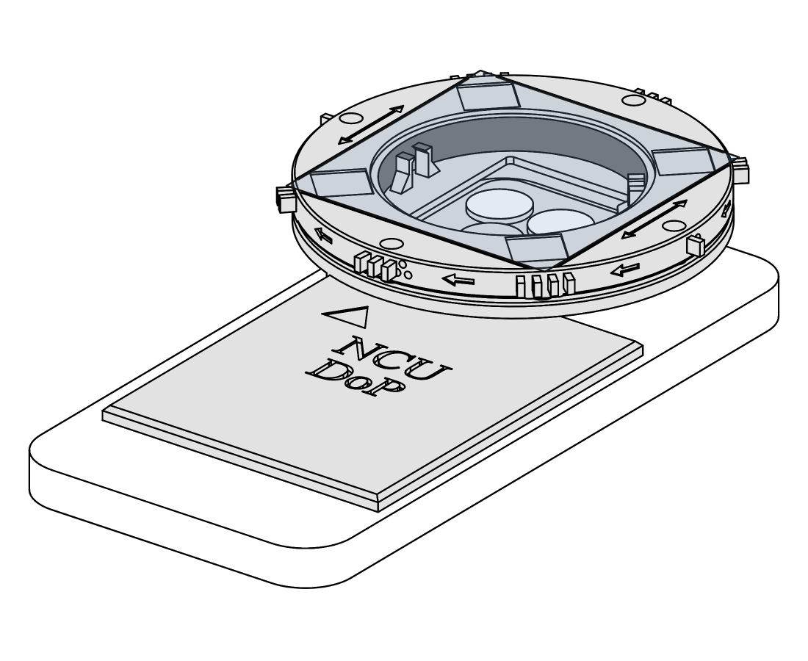

Fig. 1. Rotator mounted on the iPhone. The base stays fixed; the dial carries the polarizer.

## 2. Before you start

Keep the 15 small, strong magnets and the MagSafe magnet sticker away from children, pets, pacemakers and other medical implants. Swallowed magnets are dangerous.

Keep the round magnets in one stack. Insert them without flipping them. Cut printing supports away from your hands. Press the bearing only on its outer ring. Keep dust and sand out of it.

Hold the polarizer by its edges. Leave its protective film on while finding its axis. Remove the film after fitting the polarizer and before taking a measurement.

You will need small pliers, a utility knife, a soft cloth, a fine marker, and a blunt pin or toothpick. Work on a clean table.

## 3. Check the parts

| Part | Quantity | Purpose |
| --- | --- | --- |
| Base | 1 | Holds the bearing and carries the MagSafe plate. |
| Dial | 1 | Holds the polarizer and turns on the bearing. |
| MagSafe plate | 1 | Holds the magnet sticker and joins the base to the iPhone. |
| MagSafe magnet sticker | 1 | A ring of magnets with a tail. Outer diameter 54 mm; inner diameter 46 mm. Both sticky sides are covered by blue film. |
| Thin ball bearing | 1 | 50 × 65 × 7 mm. Lets the dial turn smoothly. |
| Round magnets | 12 | Eight in the base and four in the dial. They make the dial click into place. |
| Cube magnets | 3 | 4 × 4 × 4 mm. Hold the bearing's inner ring against the base. |
| Linear polarizer | 1 | 60 × 60 mm. Filters light along one axis. |
| Nano gel pads | 9 | 10 × 10 mm. Four hold the polarizer; five join the MagSafe plate to the base. |

The base stays fixed on the iPhone. The dial turns. The base pointer reads the groups of one, two, three or four ridges on the dial. The direction arrows show which way to turn. The double-headed arrows mark the 0° polarizer axis.

| Position | Ridges at the pointer | Angle |
| --- | --- | --- |
| 1 | 1 | 0° |
| 2 | 2 | 45° |
| 3 | 3 | 90° |
| 4 | 4 | 135° |

Each ridge count appears twice, on opposite sides. Both give the same polarizer angle. The dial clicks every 45°, eight times in one turn (Fig. 2, Fig. 3).

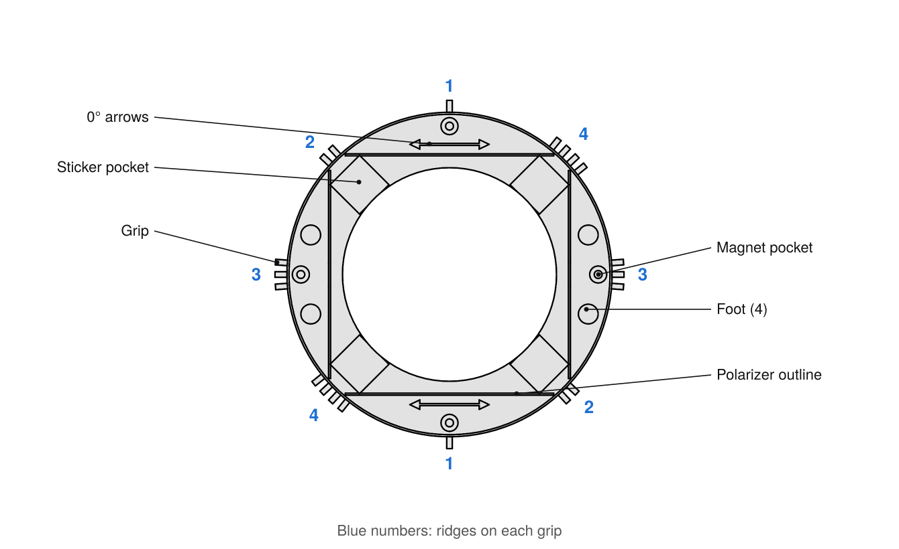

Fig. 2. Dial guide: four pad pockets, direction arrows, axis arrows and groups of one to four ridges.

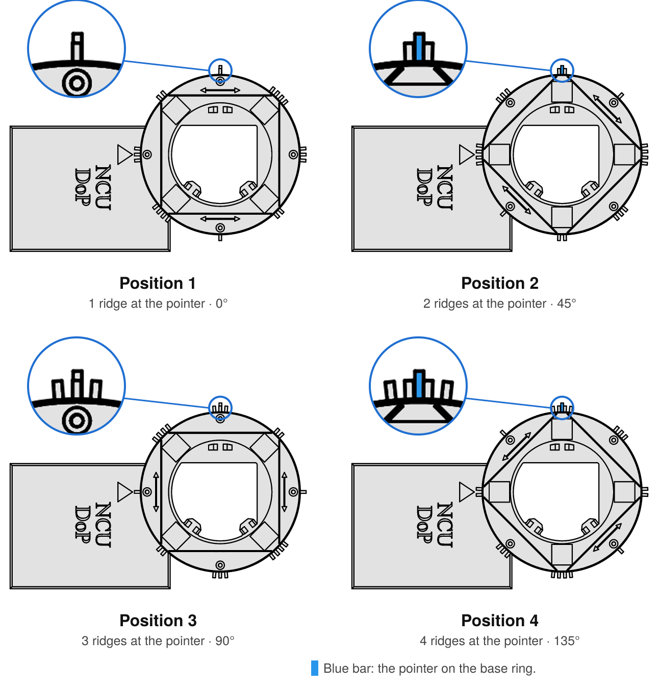

Fig. 3. Positions 1–4 correspond to 0°, 45°, 90° and 135°. Read the ridge group at the base pointer.

## 4. Assemble the rotator

Watch the calibration, bearing and MagSafe installation animation online: https://teyuan-lab.github.io/S012Cam-webpage-manual/rotator.html#assembly-movie

### Step 1. Check the printed parts

If your print used supports, remove the large pieces with small pliers and carefully trim any residue. Always cut away from your hands. If it was printed without supports, skip removal. Check that the magnet pockets, bearing recess and cube magnet seats are clear.

### Step 2. Insert the round magnets

Keep all 12 magnets stacked. Slide each magnet off the same end. Always insert the same face first. Press eight into the base and four into the dial until flush. If one is reversed, push it out through the small hole behind its pocket with a blunt pin and flip it (Fig. 4, Fig. 5).

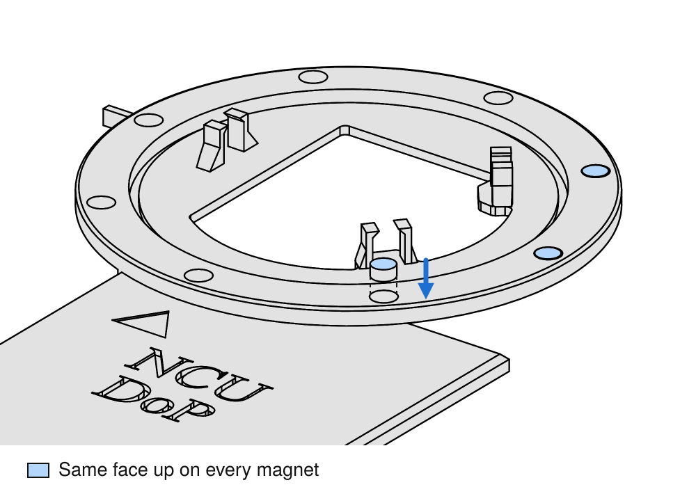

Fig. 4. Keep the same face up on every round magnet. Slide each magnet from the same end of the stack.

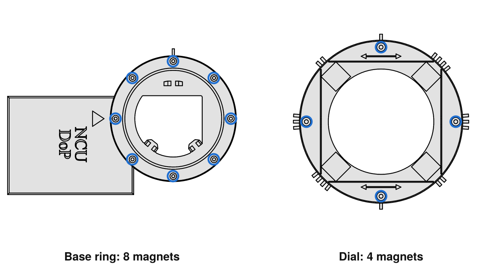

Fig. 5. Eight round magnets go in the base; four go in the dial.

### Step 3. Fit the bearing

Turn the dial upside down. Put the bearing in its round recess. Press evenly around the outer ring until it reaches the lip (Fig. 6).

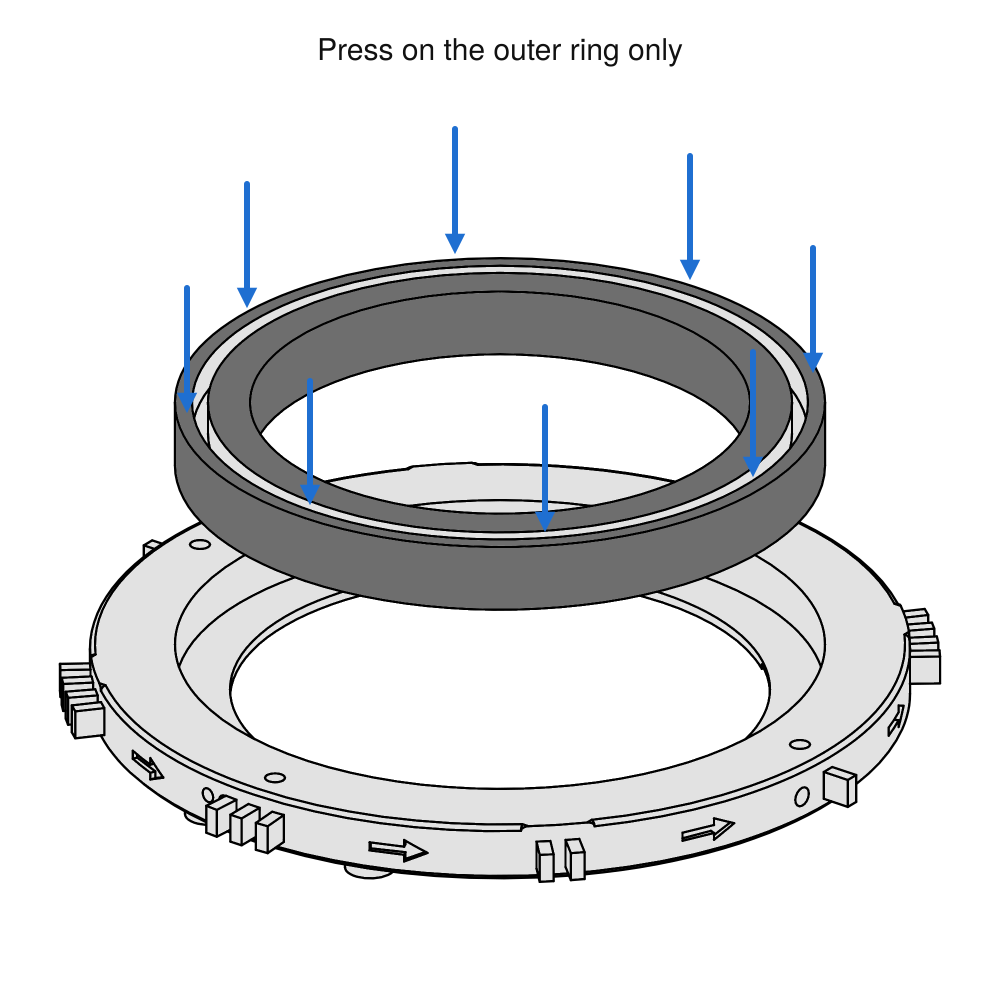

Fig. 6. Press evenly on the bearing outer ring only.

### Step 4. Join the dial and base

Lower the dial and bearing onto the base. The bearing's inner ring slides over the raised hub (Fig. 7).

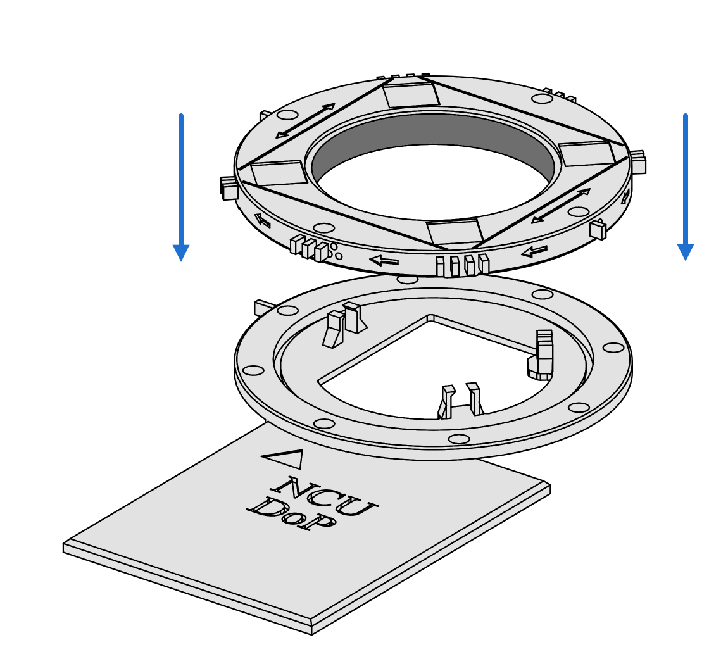

Fig. 7. Lower the dial and bearing together onto the base hub.

### Step 5. Insert the cube magnets

Through the centre of the dial, put the three cube magnets in their seats. They hold the bearing's inner ring against the base (Fig. 8).

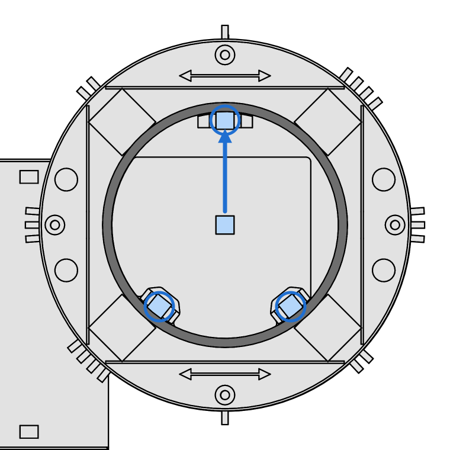

Fig. 8. The three blue circles show the cube magnet seats.

### Step 6. Test the dial

Turn the dial once in the direction of the arrows. It should click and hold every 45°, with no scraping. The gap between dial and base is about 1 mm. The cube magnets stay with the base and inner ring; they do not turn with the dial. If a stop repels the dial, reverse the round magnet at that stop (Fig. 9).

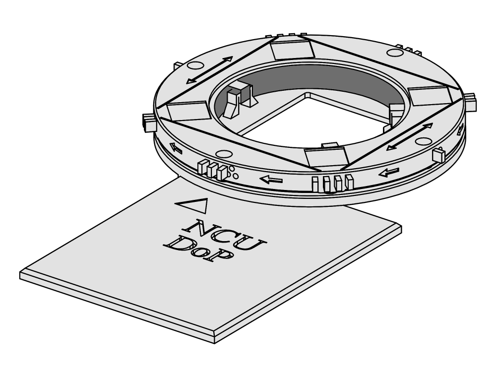

Fig. 9. Check the assembled rotator before fitting the polarizer. The dial must turn without scraping.

## 5. Fit and check the polarizer

### Find its transmission axis

1. Leave the protective film on.
2. Look at glare on a flat horizontal surface, such as a glass table, from a low angle.
3. Hold the polarizer in front of one eye. Turn it slowly until the glare is darkest.
4. Without turning it again, draw a short vertical line near one corner on the film. This marks the transmission axis (Fig. 10, Fig. 11, Fig. 12).

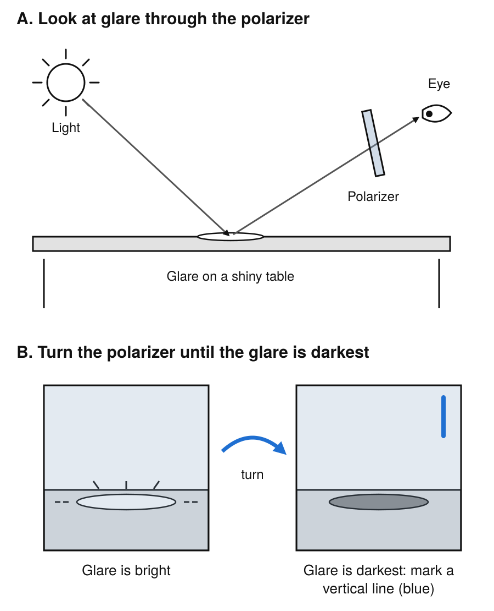

Fig. 10. Look at glare through the polarizer and turn it until the reflection is darkest.

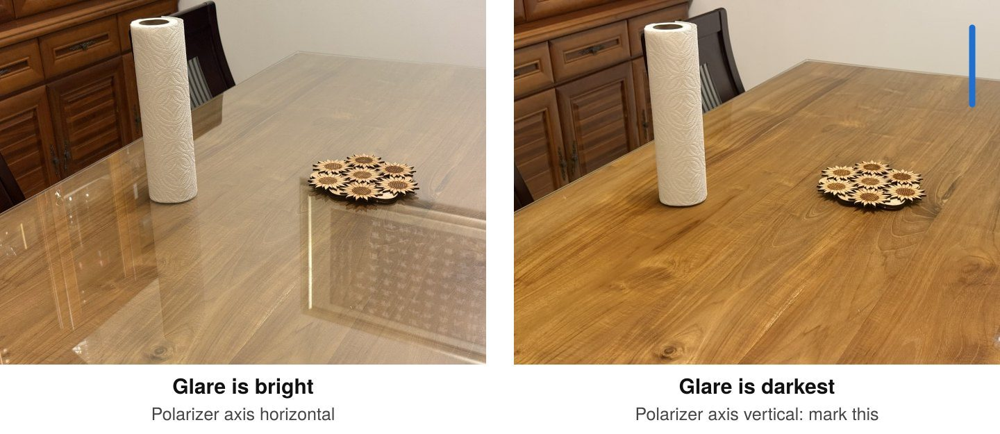

Fig. 11. The same glass table: bright glare on the left; glare suppressed on the right.

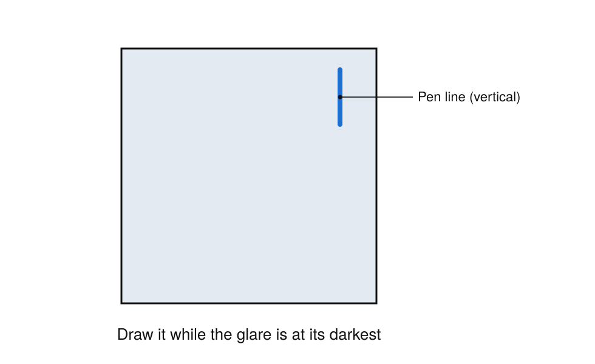

Fig. 12. Mark the vertical transmission axis on the protective film while the glare is darkest.

### Fit it to the dial

1. Set the dial to position 1, with one ridge at the pointer.
2. Put four gel pads in the four dial pockets. Peel the top liners.
3. Keep the polarizer's protective film facing up. Line up its pen mark with the double-headed arrows. Match its edges to the engraved outline.
4. Press the four corners onto the pads. Remove the protective film. The corners extending slightly beyond the dial are normal (Fig. 13, Fig. 14).

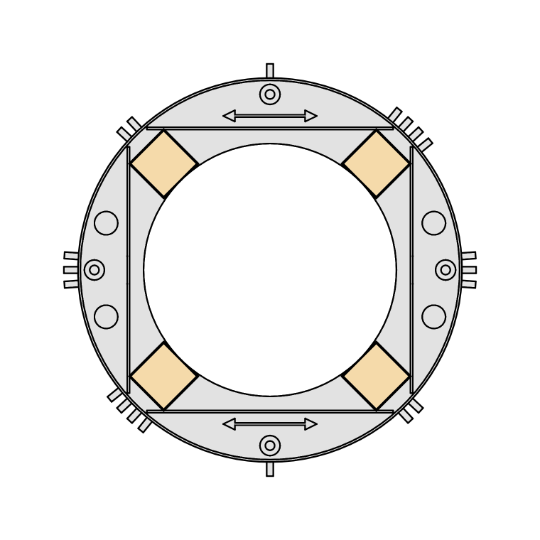

Fig. 13. Four gel pads hold the polarizer in the dial pockets.

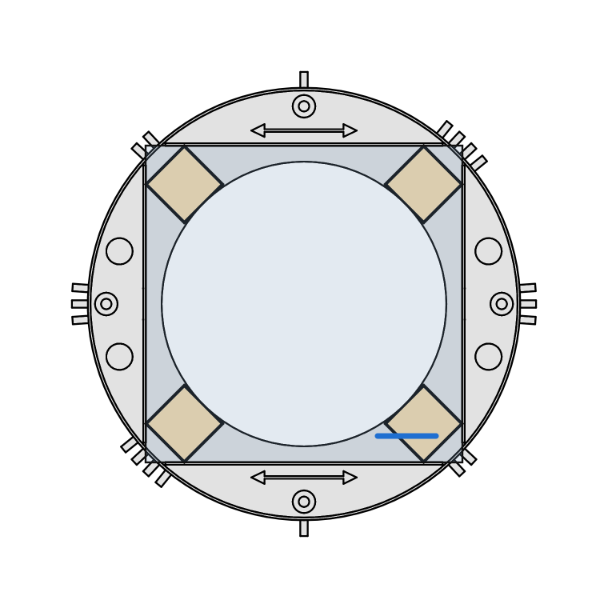

Fig. 14. Align the transmission-axis mark with the double-headed arrows at position 1.

## 6. Fit the MagSafe plate and mount the rotator

### Fit the magnet sticker

1. With both blue films still on, try both sides of the magnet sticker against the iPhone. Find the side that holds firmly.
2. Peel the blue film from that side. Press that side into the ring groove on top of the MagSafe plate. Put the tail in the slot. The two small ears belong to the film and come away with it.
3. Press firmly around the whole ring. Leave the second film on until joining the plate to the base.

### Join the plate to the base

1. Put the five remaining gel pads in the five square pockets: one at the centre and one at each corner.
2. Peel the pad liners and the sticker's second blue film.
3. Align the MagSafe plate with the back of the base, edge to edge. Its flat back faces the iPhone.
4. Press the plates together for 10 seconds (Fig. 15).

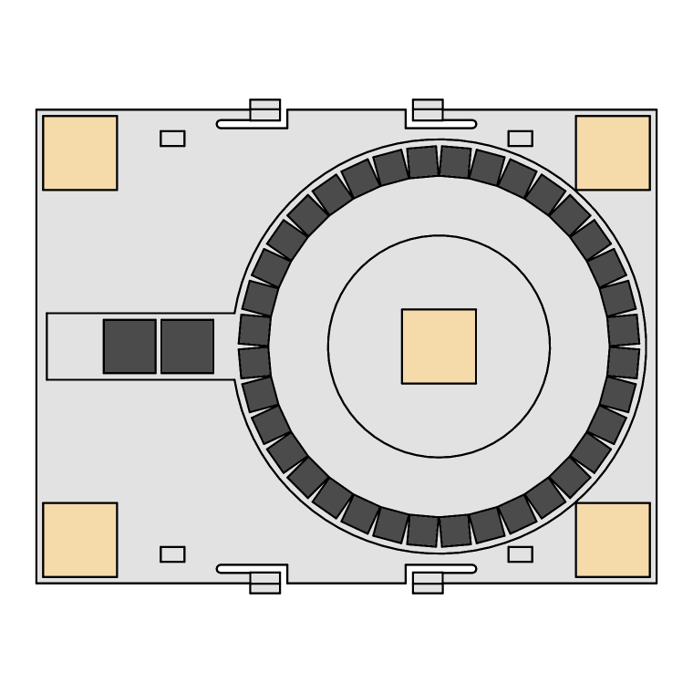

Fig. 15. MagSafe plate: the ring and tail hold the magnet sticker. Five gel pads join the plate to the base.

### Mount and check

Wipe the back of the iPhone with a soft cloth. Snap on the rotator with the camera window over the lenses. Open S012Cam and check every available camera. If an edge is blocked, lift the rotator off and mount it again.

For the full ultra wide view, remove the iPhone case. A case can block the upper-left corner of this view.

Before the first measurement, hold the iPhone level and measure glare on a flat horizontal surface. The result should show horizontal polarization. If it shows vertical, refit the polarizer after turning it 90°.

## 7. Camera screen

Hold the iPhone sideways. The photograph shows an iPhone 16 Pro before photo 1. Match each blue number to the descriptions below. The version number is no longer shown on the camera screen (Fig. 16).

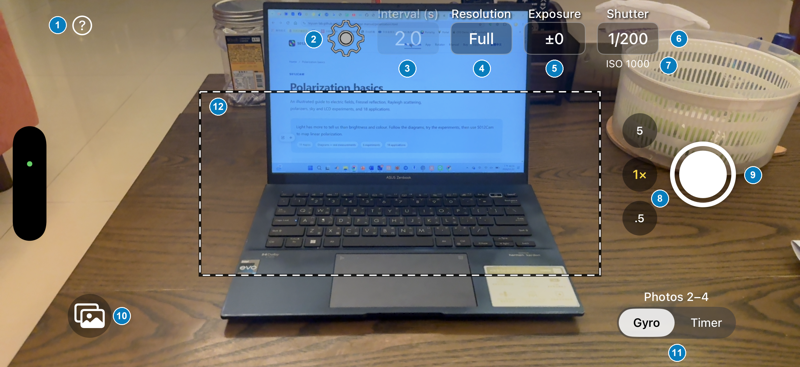

Fig. 16. Latest supplied camera screenshot (November 2026), with the same 1–12 control numbers. This example shows Full resolution, shutter 1/200 s and ISO 1000. These are captured settings, not a statement that all are defaults.

| No. | Control | What to do |
| --- | --- | --- |
| 1 | Guide and support (?) | Tap to open the S012Cam website. |
| 2 | Settings (gear) | Tap to open settings. |
| 3 | Interval (s) | Set the time between photos in Timer mode. The default is 2 seconds. Gyro mode does not use this setting, so the field is dimmed. |
| 4 | Resolution | Choose the calculation resolution: Full, 1/2, 1/3, 1/4, 1/5, 1/6, 1/8 or 1/10. Lower resolutions calculate faster. |
| 5 | Exposure | Adjust exposure compensation from −2 to +2 EV in 1/3 EV steps. Try this when the red or blue channel is weak. |
| 6 | Shutter | Choose 1/60 to 1/1000 s, or Custom. The default 1/200 s suits handheld use. If photos are repeatedly rejected as blurred, choose a faster shutter. |
| 7 | ISO | The app chooses ISO. Tap the preview to meter while keeping the selected shutter. ⚠ means ISO reached its limit. The image may be too dark or bright, or the shutter may have been lengthened. |
| 8 | Camera buttons | Tap to choose a camera; yellow marks the selection. This iPhone shows 5, 1× and .5 from top to bottom. Available cameras depend on the model; see section 1. |
| 9 | Shutter button | Press at 0° for photo 1. In Gyro mode, turn the dial and hold still for automatic photos 2–4. Press during a set to capture the current photo immediately. |
| 10 | Saved measurements | Tap to open the saved measurements list. |
| 11 | Photos 2–4 | Choose Gyro or Timer. Gyro is the default. Turn the dial, hold still and wait for the automatic photo. Timer uses the fixed interval set at number 3. |
| 12 | Dashed measurement box | Keep the subject inside. After photo 1, its outline helps align the next photos. The eye button shows or hides the outline; it is not yet visible here. |

## 8. Take a four-angle set

First choose how to support the iPhone, then choose how photos 2–4 are triggered. These are separate choices.

| Setup | Suggested capture mode | Calculation |
| --- | --- | --- |
| Handheld iPhone + Rotator | Gyro; Timer is also available | Align and Calculate. |
| Tripod or secured iPhone + Rotator | Timer is convenient; Gyro is also available | Calculate Without Aligning if the phone and scene stayed fixed. |
| Secured iPhone + hand-held polarizer | Timer | Calculate Without Aligning if fixed. Hand-estimated angles are not a quantitative reference. |

### Case 1. Hold the iPhone and use the Polarizer Rotator

Hold it sideways with both hands, screen facing you, as shown in Fig. 17(a). Your right thumb controls the screen. Your left middle finger turns the dial. From your view, the dial turns counterclockwise. Turn one click at a time. Keep your elbows against your body and tap gently.

Choose a still subject under steady light. Keep the subject inside the dashed measurement box (12). Tap the preview to focus and meter. This keeps the selected shutter and changes ISO. The default shutter of 1/200 s suits handheld use.

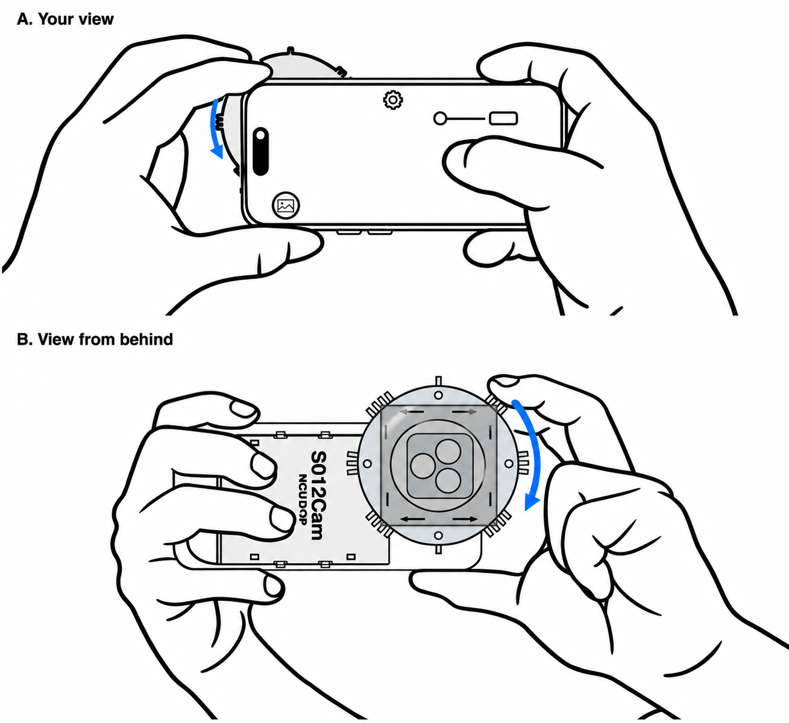

Fig. 17. Handheld operation. (a) Screen side: hold the iPhone with both hands and turn the dial counterclockwise with the left middle finger. (b) Camera side: the same grip seen from behind, with the square polarizer mounted over the circular lid and covering the camera opening. The blue arrows show the same physical rotation from opposite sides.

### Case 2. Use a tripod or secure the iPhone

Mount the iPhone on a steady tripod or place it on a firm support where it cannot slip. Fix the framing and camera direction. Do not push the phone when turning the Polarizer Rotator or touching the screen. Keep both the phone and the subject still for all four photos.

You can use Gyro or Timer. With a firmly mounted phone, turning the polarizer may not move the phone enough for Gyro to detect a turn. Timer is convenient in this case. Allow enough time to turn the dial and let vibration stop. After all four photos, choose Calculate Without Aligning to calculate directly without image alignment.

A tripod does not guarantee alignment if the phone, subject or framing moved. Choose Align and Calculate or retake the set in that case.

### Gyro mode: one shutter press

1. Set Photos 2–4 (11) to Gyro, the default. Set the dial to position 1, at 0°.
2. Press the shutter (9) to take photo 1.
3. An outline of photo 1 appears over the live view. Follow the next-angle prompt, for example: “Photo 1 ✓ Turn to … · 45°”.
4. Turn the dial to position 2, at 45°. Hold still and line up the view with the outline. The allowed shift is 3% of the frame. The gyroscope senses the turn. Once the iPhone is steady and the view lines up, photo 2 is taken automatically.
5. Repeat at position 3 (90°) and position 4 (135°). Hold still after each turn.
6. After all four photos, choose Align and Calculate or Calculate Without Aligning.

If the phone does not sense movement, the prompt may stay at “Turn to XX” instead of changing to “Hold still”. After turning the polarizer to the requested angle, lightly touch or gently tap the phone once, then hold it steady. The app can then continue waiting for steadiness and capture. Keep the framing unchanged.

The eye button shows or hides the photo 1 outline. It appears after photo 1, so it is not visible in the numbered camera-screen photograph.

The white outline inside the dashed measurement box provides the reference while “Hold still…” is displayed (Fig. 18). Keep the actual scene lined up with it. The eye button at the lower left hides or shows the outline; it does not turn alignment checking off. Keep a display scene static during the set, just as you would keep other subjects still.

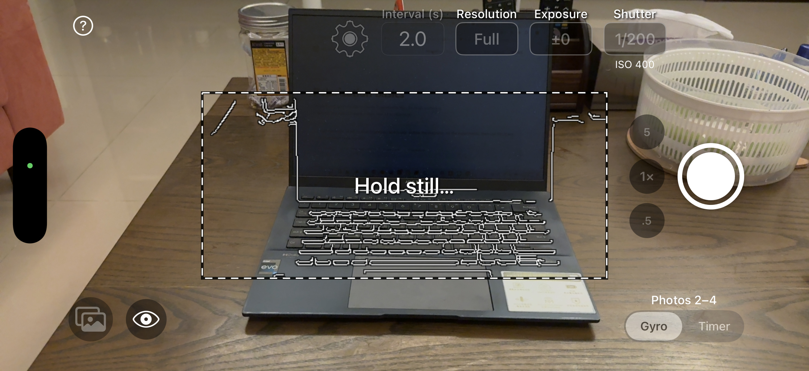

Fig. 18. Actual Gyro capture screen after photo 1. The white outline and eye button are visible. “Hold still…” means the app is waiting for steadiness.

### Checks and retakes

Each photo is checked for blur and position immediately. If it fails, the app explains why and asks you to hold still. Keep the dial at the current angle. Only that angle is retaken. Earlier photos are kept.

“Hold still…” means the app is waiting for the iPhone to settle. A plain area, such as a white wall, has too little texture for the position check. The message is: “Plain area: position is not checked — keep the phone steady.” Keep the phone steady yourself.

If no photo is taken for about 8 seconds after the prompt, these buttons appear:

| Button | Action |
| --- | --- |
| Capture now | Take the current photo now. |
| Redo previous | Retake the last photo. |
| Cancel | Stop the set. |

The shutter button always works. Press it during a set to take the current photo immediately.

### Timer mode

Set Photos 2–4 (11) to Timer. Set Interval (3), 2 seconds by default. Press the shutter for photo 1. Turn the dial to each prompted angle before the next interval ends. Photos 2–4 use the fixed interval. In Gyro mode, Interval is dimmed because it is not used.

### Without a Rotator: use a hand-held polarizer

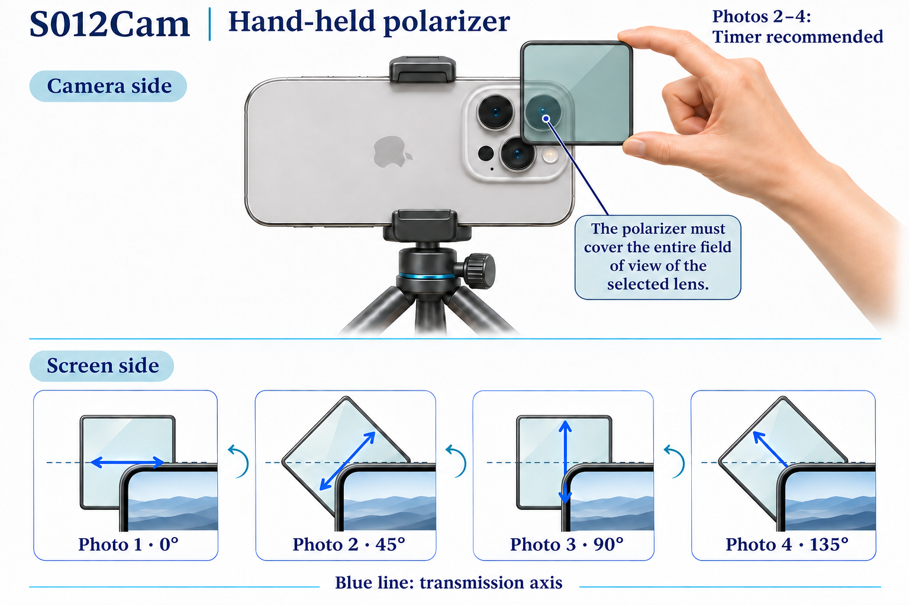

Fig. 19. Use a tripod or firm support and select Timer for Photos 2–4. The upper view is from the camera side. The lower views are from the screen side, with a phone screen corner in the foreground. Blue lines mark the transmission axis at 0°, 45°, 90° and 135°. Keep the selected lens's entire field of view within the clear filter at every angle.

1. Mount the iPhone on a tripod or secure it on a firm support. Choose a still scene.
2. Hold the linear polarizer by its edges in front of the selected camera. The entire field of view must pass through the clear area of the polarizer at all four angles. Use a large enough sheet and hold it close to the lens without touching it. Keep fingers and the filter frame out of the view. Keep the polarizer roughly parallel to the back of the phone. Check the preview at each angle for blocked edges or dark corners.
3. Set the transmission axis along the long edge of the landscape iPhone for 0°. The edge of the filter is not necessarily its transmission axis.
4. Set Photos 2–4 (11) to Timer. The default interval is 2 seconds. Use a longer interval if you need more time to turn and settle.
5. Press the shutter for photo 1. From the screen side, turn counterclockwise to 45°, 90° and 135°, measured from the starting position. Follow the prompt, reach each angle before the next photo, and hold still.
6. Do not move the iPhone. If the phone and scene stayed fixed, choose Calculate Without Aligning after photo 4 (Fig. 19).

Hand rotation makes the angle, tilt and position hard to repeat. This method can show polarization patterns, but its values are not a quantitative reference. Securing the phone and using Timer reduce handling disturbance; they do not remove polarizer angle errors. This limitation applies only to a hand-held polarizer with hand-estimated angles. With a correctly fitted and calibrated Polarizer Rotator, captured at its indexed positions, the measurement values can be used as a reference.

### Align and calculate

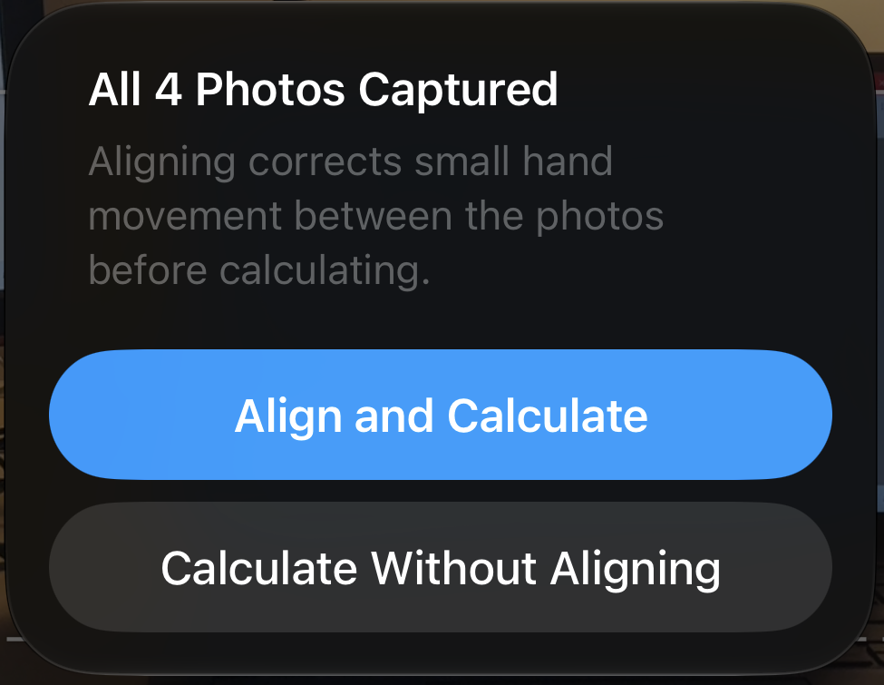

Fig. 20. The actual four-photo completion dialog. Align and Calculate is above Calculate Without Aligning. Cropped from the supplied screenshot.

For a handheld iPhone, choose Align and Calculate to correct small shifts. With a tripod or a secured iPhone, choose Calculate Without Aligning if both the phone and scene stayed fixed for all four photos. It calculates from the photos as captured (Fig. 20).

If “Photos Don’t Line Up” appears, check the percentage of the measurement box that lines up in all four photos (Fig. 21). In this example only 10% lines up; the magenta overlay identifies areas that do not line up. Moving leaves, water, people, shadows or parallax between near and far objects can cause this. Choose Retake to capture a new set after correcting the cause. Continue without aligning calculates from displaced photos and may create false polarization along edges; use it only when you understand that limitation. If the app offers Use aligned areas (…%) in another case, only the accepted area is used.

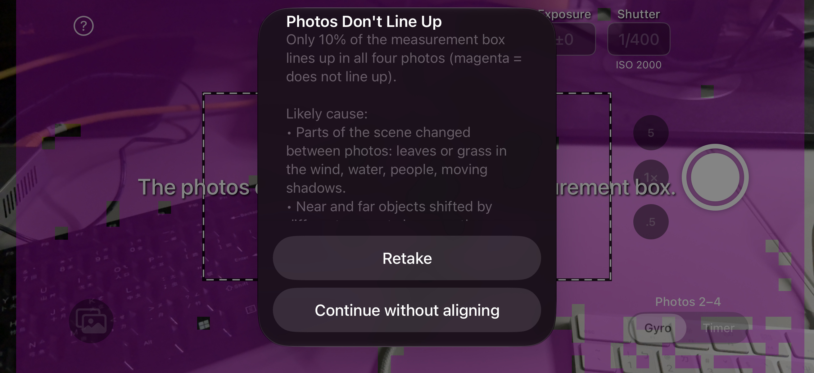

Fig. 21. Actual alignment warning. Only 10% of this measurement box lines up. The visible choices are Retake and Continue without aligning. The percentage belongs to this example, not a fixed acceptance threshold.

Scenes with very near and far objects can fail alignment because of parallax. Step back, choose a flatter scene or use a tripod. If photos are rejected as blurred, choose a faster shutter. Keep people, moving leaves and waves out of the measurement area when possible (Fig. 22).

Fig. 22. The same scene with aligned photos (left) and displaced photos (right). Displaced edges can create false polarization colours.

## 9. Read the result

| View | How to read it |
| --- | --- |
| **AoLP+DoLP** | Hue shows the polarization angle. Brightness shows the degree of linear polarization. |
| **DoLP** | Degree of linear polarization. Black is **0** and white is **1**. |
| **AoLP** | Angle of linear polarization. Match the hue to the legend. The app reports angles from **0° to less than 180°**, measured from the Photo 1 orientation toward Photo 2. Black marks an undefined angle. |

Select **RGB** for the combined result or **R**, **G**, or **B** for one colour channel. The combined result averages the three channels' linear Stokes values before calculating DoLP and AoLP.

**Every image view supports touch zoom and tapping**, including AoLP+DoLP, DoLP, AoLP and the RGB, R, G and B channels. Pinch to zoom, drag to move around, and tap **1×** when visible to reset the view. Tap the result image to open it full screen, then tap a point to read its values and see its position on the legend. Angles that differ by **180°** describe the same polarization direction. Treat the angle cautiously where DoLP is very low.

Open **Tap for details** to see the alignment status and any exposure warnings. If you used partial alignment, magenta areas have no usable measurement.

### Example 1. Read the result screen

Compare the laptop and table scene across display modes and colour channels (Fig. 23). The main view is AoLP+DoLP (RGB): hue encodes linear-polarization angle and brightness encodes linear-polarization degree. These are not the objects’ original colours.

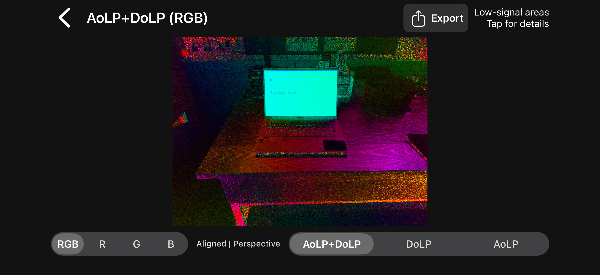

Fig. 23. Latest supplied result overview. The display, keyboard, palm rest and table show different polarization patterns. The bottom status reads Aligned | Perspective; the upper-right warning is Low-signal areas.

Use the lower-left buttons for RGB, R, G or B, and the lower-right buttons for AoLP+DoLP, DoLP or AoLP. Aligned | Perspective describes this result’s alignment state; it does not guarantee that every pixel is free of error. Export is at the top.

Open Tap for details to inspect low-signal, overexposure or other warnings for that measurement. This example shows Low-signal areas only; every warning does not appear on every capture. Coloured speckles in dark areas should not be treated as reliable polarization detail.

### Example 2. Read angle and degree at a point

Tap the result to open the full-screen reading view, then tap a location. The cross and the numbers at the top refer to the same sampled point (Fig. 24). Here the cross is on the laptop palm rest, not the LCD.

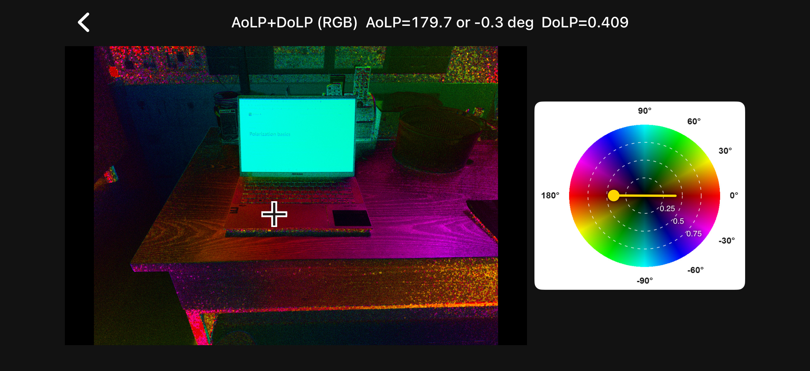

Fig. 24. The selected palm-rest point reads AoLP = 179.7°, equivalently −0.3°, and DoLP = 0.409. The values describe only the location marked by the cross.

179.7° and −0.3° differ by 180° and describe the same linear-polarization axis. The yellow marker’s direction on the wheel indicates AoLP; its radius indicates DoLP. The centre is 0 and the rim is 1. A DoLP of 0.409 is about 40.9% at this point; it does not describe the entire palm rest or display.

### Zoom before selecting a point

Pinch to zoom and drag to pan in the full-screen view, then tap a detail. When 1× appears at the upper right, tap it to reset the view (Fig. 25). Touch navigation is available in AoLP+DoLP, DoLP and AoLP, and in RGB, R, G and B.

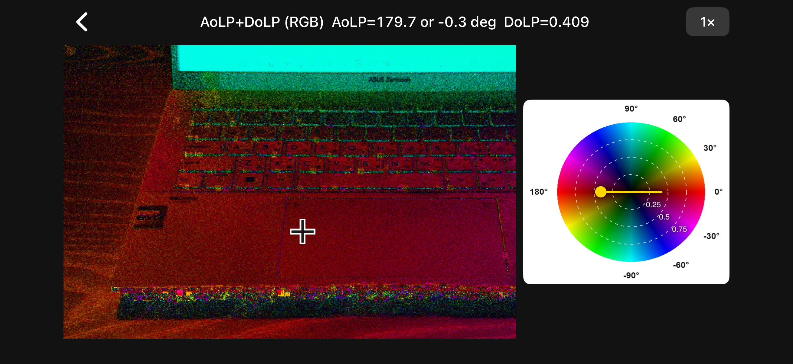

Fig. 25. The same example after zooming, with the 1× reset button. The reading remains AoLP = 179.7° / −0.3°, DoLP = 0.409. Display zoom does not increase measurement resolution or change the value at the same sampled point.

### Example 3. Read the DoLP view

Black means DoLP = 0 and white means DoLP = 1. The grayscale represents linear-polarization degree, not ordinary photographic brightness. Tap a location, read its value at the top and find the yellow marker on the grayscale bar (Fig. 26).

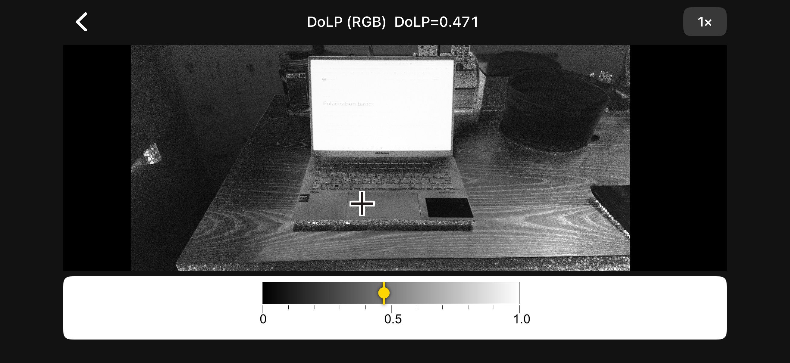

Fig. 26. Latest supplied DoLP (RGB) view. The selected palm-rest point reads 0.471. Its location differs from Fig. 24, so the readings need not match; being in the same scene does not make the points interchangeable.

The display is brighter in this DoLP map, while the palm rest and table have other grayscale levels. Sample each region and inspect quality warnings before comparing values. False colour or brightness alone does not establish reliability.

## 10. Save, share and export

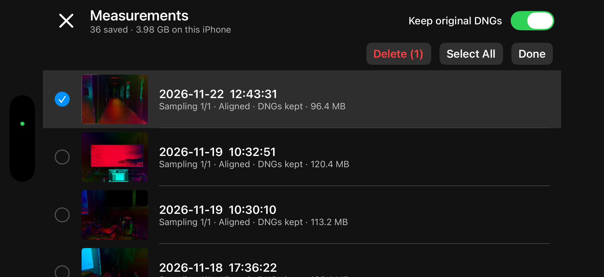

Fig. 27. Latest supplied Measurements screen, already in selection mode. It shows 36 saved measurements and 3.98 GB on this iPhone, with one row selected. These counts and sizes are examples.

Keep original DNGs is on at the top right. The checked blue circle marks one selected measurement, so the action reads Delete (1). Select All selects every row; Done exits selection mode. Tap Done before tapping a row to reopen it. Each row shows the capture date, sampling, alignment, DNG status and size. Check the selection before deleting; sharing and deletion are explained below (Fig. 27).

### Find and reopen a measurement

1. From the result screen, tap the back arrow to return to the camera. Tap the **Measurements** icon at the lower left.
2. Find your capture by its date and time. The newest measurements appear first. Each row shows a thumbnail, file size, whether DNGs are present, and sampling and alignment information when available.
3. Tap a row to reopen its result. If **Done** is showing, tap it first to exit selection mode.

S012Cam saves completed measurements on the iPhone. If the result reports **Save incomplete**, tap **Tap for details** to see which files could not be saved.

### Choose whether to keep the original RAW photos

In **Measurements**, set **Keep original DNGs** before starting a new capture. It is on by default and keeps all four original RAW photos. Turn it off to save space. The app still saves the data needed to reopen the result and export its maps. Each saved measurement keeps the DNG setting used when it was captured.

### Share or back up the whole measurement

1. In **Measurements**, swipe left on the row and tap **Share**.
2. In the iPhone share sheet, choose a destination such as AirDrop or **Save to Files**, if offered. To save a separate copy, choose a location outside the S012Cam folder.
3. Open the destination and check that the folder and any files you need are there before deleting the original.

For a new measurement, the folder includes `measurement.json` (capture settings), `input_1.tiff` through `input_4.tiff` (the data used to calculate the result), and `1.dng` through `4.dng` if you kept the originals. If you have already exported the result, it also includes the `export` subfolder. To browse measurement folders directly, open **Files › Browse › On My iPhone › S012Cam**.

### Delete measurements

- **One measurement:** Swipe left on its row, tap **Delete**, then tap **Delete** again in the confirmation.
- **Several measurements:** Tap **Select**, then tap the rows you want. To choose every entry, tap **Select All**. Tap **Delete (n)** and check the count and storage shown before confirming. Tap **Done** to leave selection mode if you decide to keep the files.

Deleting a measurement in S012Cam permanently removes its entire folder from the iPhone, including its original DNGs and any exports stored inside it. Share or copy the files you want to keep first.

### Export a measurement

1. Open the result and tap **Export**.
2. When **Export Complete** appears, tap **Share…** and choose a destination in the share sheet. This shares the `export` subfolder with the result maps and export notes. To share the original captures and calculation data too, use **Share** on the measurement row in section 10.
3. To find the exported files later, open **Files › Browse › On My iPhone › S012Cam**, open the measurement folder, then open **export**.

| File | Use |
| --- | --- |
| **PNG** | Display images for **AoLP+DoLP**, **DoLP**, and **AoLP**, for the combined result and individual colour channels. |
| **32-bit floating-point TIFF** | Per-pixel **S0**, **S1**, **S2**, **DoLP**, and **AoLP** maps for quantitative analysis. AoLP is in degrees. Invalid or undefined values are stored as **NaN**. |
| **export.json** | File list, map dimensions, and notes on units and pixel values. |

If an older measurement is listed as **Pictures only**, it can show its saved images, but exact values are unavailable for export.

## 11. Remove the rotator and care for it

Hold the iPhone firmly. With the other hand, hold the base near one end of its mounting plate. Tilt it away from that end, like another MagSafe accessory. Do not pull or twist the dial.

The gel pads stay on the rotator. You do not need to remove them to take the rotator off. If you remove the polarizer or MagSafe plate and the pads become dusty, rinse the pads with clean water. Do not use soap, alcohol or tissue. Let them air-dry completely before fitting them again.

Clean the polarizer with a soft dry cloth. Do not use alcohol or solvents. Keep the rotator away from sand and water. Do not leave it in a hot car or in strong direct sun for long periods.

## 12. Troubleshooting

| What you see | What to do |
| --- | --- |
| Camera Permission | Open Settings and allow camera access for S012Cam. |
| An expected camera is absent | Buttons depend on the iPhone model. Wait for startup calibration. Use an available camera. |
| Stays at “Turn to XX”, not “Hold still” | Turn to the requested angle, lightly touch or gently tap the phone once, then hold still without changing the framing. |
| No automatic photo in Gyro mode | Turn to the prompted angle, then hold still and match the outline. After about 8 seconds, use Capture now, Redo previous or Cancel. The shutter also captures immediately. |
| Plain area message | Position cannot be checked in a textureless area. Keep the phone steady or frame a textured subject. |
| Repeated blur rejection | Use a faster shutter and support the iPhone. Keep the current dial angle while the app retries. |
| Next photo comes too soon in Timer mode | Increase Interval. Follow the angle prompt before each photo. |
| ISO warning or weak signal | Check ISO (7) and Tap for details. Adjust Exposure (5) or Shutter (6) before retaking a full set. |
| Coloured fringes or alignment failure | Hold steadier, use a tripod, step back or choose a flatter scene. Try Align and Calculate. |
| Angles consistently wrong | Check the 0° axis and the order 0°, 45°, 90°, 135°. Repeat the polarizer check in section 6. |
| A dial stop repels | Push the round magnet out through its rear hole and flip it. |
| Dial does not click or scrapes | Check all 12 round magnets are flush. Re-seat the bearing and remove support material or dirt. |
| Dark corners | Re-centre the camera window. Remove the case for the full ultra wide view. |
| Rotator slips | Check the magnet sticker orientation in section 6. |
| Plate or polarizer comes loose | Rinse dusty gel pads with water and air-dry them completely. |

Support: https://teyuan-lab.github.io/S012Cam-webpage-manual/

App Store: https://apps.apple.com/app/id6834323253

Contact: teyuan@gmail.com

Department of Optics and Photonics, National Central University, Taiwan.
