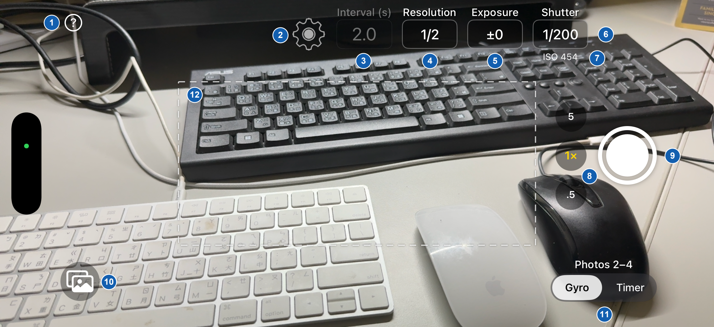
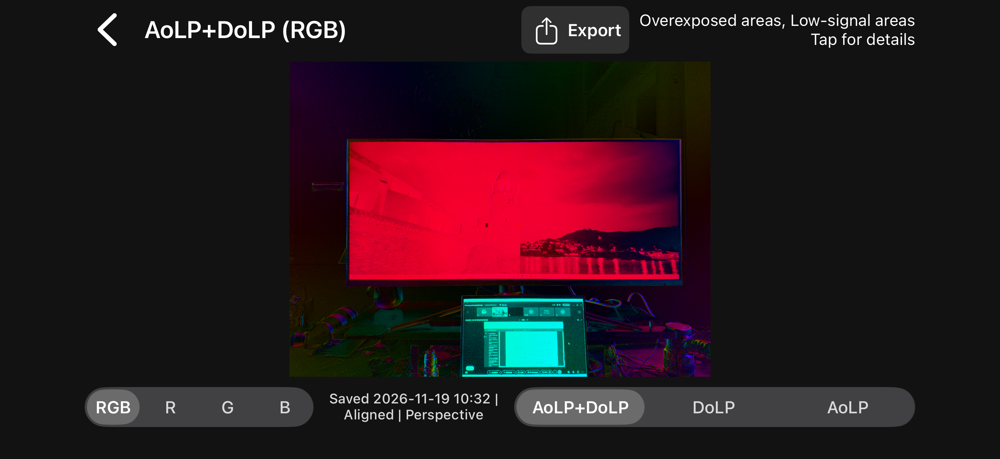
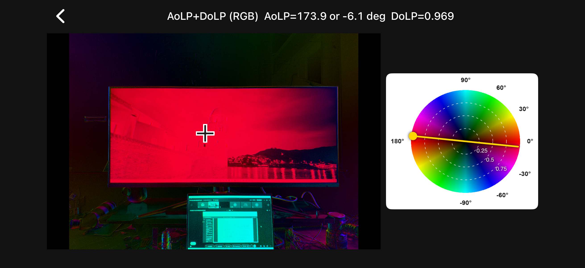
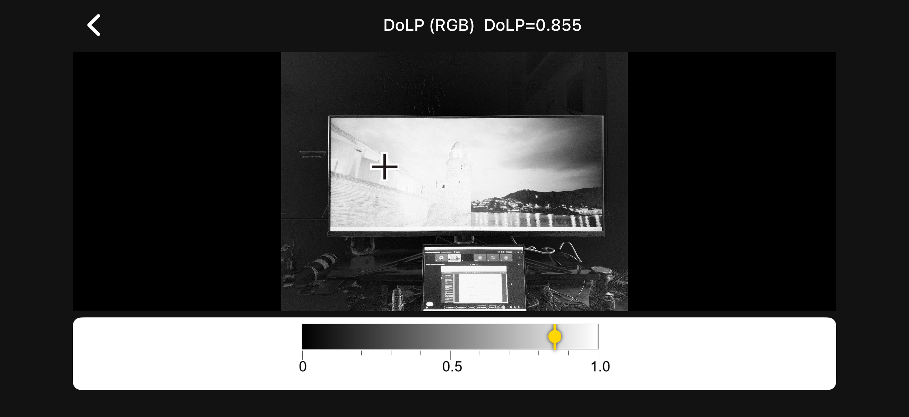
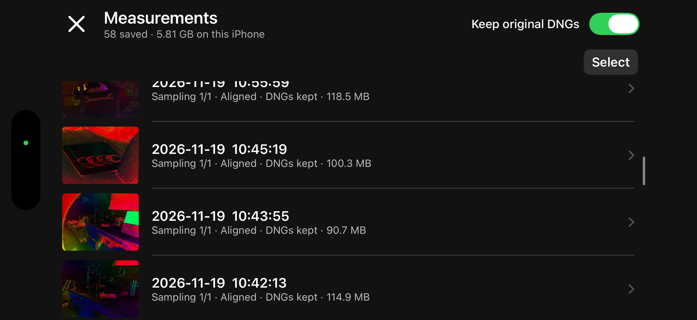

# S012Cam 使用者手冊

App 版本 2.0 · 2026 年 11 月 21 日

## 1. 認識 S012Cam 與相容性

S012Cam 讓 iPhone 成為偏振相機。透過線性偏光片，拍攝同一場景在 0°、45°、90° 和 135° 的四張照片，再計算線偏振度與線偏振角。第一次可以拍玻璃反光、藍天，或放在 LCD 螢幕前的透明塑膠。

App 適用於 iOS 15.6 或更新版本的 iPhone，並以 iPhone 16 Pro 開發與測試。舊款 iPhone 計算一次量測可能需要較長時間。

每款 iPhone 皆顯示 1×。具備超廣角鏡頭者顯示 0.5×；具備望遠鏡頭者顯示 2×、3× 或 5×。例如 iPhone 12 Pro 為 2×，13 Pro 和 14 Pro 為 3×，15 Pro Max 和 16 Pro 為 5×。手機沒有的鏡頭不會顯示。

你可以使用轉盤，也可以將一片線性偏光片放在鏡頭前手動轉動。沒有轉盤時，先讓偏光片透光軸平行於 iPhone 長邊，作為 0°，再依序轉到其餘三個角度。可選 Timer 並加長間隔，留時間轉動。

## 2. 開始前的準備

套件有 15 顆小型強力磁鐵及 MagSafe 磁鐵貼片。請遠離兒童、寵物、心律調節器與其他植入式醫療裝置。吞入磁鐵有危險。

圓磁鐵保持疊成一串，裝入時不要翻面。修整列印支撐時，刀口朝外並遠離手部。安裝軸承時只按外環，避免灰塵與沙粒進入。

拿偏光片時握住邊緣。找透光軸時先保留保護膜；貼好偏光片後再撕除。拍攝前必須撕掉保護膜。

準備小鉗子、美工刀、軟布、細筆，以及鈍針或牙籤。在乾淨的桌面操作。

## 3. 清點零件

| 零件 | 數量 | 用途 |
| --- | --- | --- |
| 底座 | 1 | 固定軸承並連接 MagSafe 底板。 |
| 轉盤 | 1 | 固定偏光片，並在軸承上旋轉。 |
| MagSafe 底板 | 1 | 放置磁鐵貼片，將底座連到 iPhone。 |
| MagSafe 磁鐵貼片 | 1 | 帶尾端的磁鐵環。外徑 54 mm、內徑 46 mm。兩面有黏性，各覆一層藍色膜。 |
| 薄型軸承 | 1 | 50 × 65 × 7 mm，讓轉盤平順旋轉。 |
| 圓磁鐵 | 12 | 底座 8 顆、轉盤 4 顆，讓轉盤在各角度定位。 |
| 方磁鐵 | 3 | 4 × 4 × 4 mm，將軸承內環固定於底座。 |
| 線性偏光片 | 1 | 60 × 60 mm，篩選沿透光軸振盪的光。 |
| 奈米凝膠貼片 | 9 | 10 × 10 mm。4 片固定偏光片，5 片連接 MagSafe 底板與底座。 |

底座固定在 iPhone 上，轉盤則可旋轉。底座指標對準轉盤邊緣的一道、兩道、三道或四道凸紋，表示目前位置。小箭頭表示旋轉方向，雙向箭頭表示偏光片的 0° 透光軸。

| 位置 | 指標對準的凸紋數 | 角度 |
| --- | --- | --- |
| 1 | 1 | 0° |
| 2 | 2 | 45° |
| 3 | 3 | 90° |
| 4 | 4 | 135° |

每組凸紋在相對兩側各出現一次，代表相同的偏光片角度。轉盤每 45° 定位一次，一圈共有 8 次。

## 4. 組裝轉盤

### 步驟 1：清除列印支撐

用小鉗子取下較大的支撐，再以美工刀修平殘料。刀口朝外，遠離手部。清理圓磁鐵孔、軸承凹槽和方磁鐵卡座。

### 步驟 2：壓入圓磁鐵

將 12 顆圓磁鐵保持疊成一串。每次從同一端滑下一顆，讓同一面先入孔。底座裝 8 顆，轉盤裝 4 顆，壓至與表面齊平。若裝反，用鈍針從孔後推出，再翻面裝回。

### 步驟 3：安裝軸承

將轉盤翻面，把軸承放入圓形凹槽。沿外環均勻按壓，直到貼住止擋。

### 步驟 4：裝到底座

把轉盤和軸承放到底座上，讓軸承內環套住底座凸台。

### 步驟 5：插入方磁鐵

從轉盤中央，將 3 顆方磁鐵分別放入卡座。它們會把軸承內環固定在底座上。

### 步驟 6：檢查旋轉

沿箭頭轉一圈。每 45° 應卡住一次，轉動時不應摩擦。轉盤與底座間約有 1 mm 間隙。方磁鐵應留在底座與軸承內環上，不隨轉盤轉動。若某一格排斥轉盤，將該格的圓磁鐵翻面。

## 5. 安裝與校正偏光片

### 找出透光軸

1. 先保留保護膜。
2. 從較低的角度，觀察玻璃桌面等水平亮面的反光。
3. 將偏光片放在眼前慢慢旋轉，直到反光最暗。
4. 保持偏光片方向不變，在保護膜靠近一角處畫一條垂直短線。這條線表示透光軸。

### 貼到轉盤

1. 將轉盤轉到位置 1，讓底座指標對準一道凸紋。
2. 在轉盤四個凹槽各貼一片凝膠貼片，撕開上層離型膜。
3. 讓偏光片保護膜朝上，筆線平行於雙向箭頭，邊緣對準刻線。
4. 按壓四角固定，再撕掉保護膜。偏光片四角略超出圓形轉盤是正常的。

## 6. 安裝 MagSafe 底板並裝上 iPhone

### 安裝磁鐵貼片

1. 先不撕藍膜，將貼片兩面分別靠近 iPhone 背面，找出吸得牢的一面。
2. 只撕掉這一面的藍膜，將它朝下壓入 MagSafe 底板的環形凹槽，尾端放入槽口。兩個小耳朵屬於藍膜，會隨膜一起取下。
3. 沿整個圓環壓牢。另一面的藍膜等連接底座前再撕。

### 連接底板與底座

1. 將剩下的 5 片凝膠貼片放入五個方形凹槽：中央一片、四角各一片。
2. 撕掉貼片上層離型膜及磁鐵貼片另一面的藍膜。
3. 將 MagSafe 底板與底座背面邊緣對齊。底板的平背面應朝向 iPhone。
4. 均勻按壓 10 秒。

### 裝上手機並檢查

用軟布擦乾淨 iPhone 背面。將轉盤吸附上去，讓鏡頭窗對準後鏡頭。開啟 S012Cam，逐一檢查可用鏡頭。若有邊緣被擋住，取下轉盤後重新吸附。

若要取得完整超廣角畫面，先取下手機殼。手機殼可能遮住超廣角畫面的左上角。

第一次量測前，保持手機水平，拍攝水平亮面的反光。結果應顯示水平偏振。若顯示垂直偏振，將偏光片轉 90° 後重新貼合。

## 7. 相機畫面

橫拿 iPhone。照片是 iPhone 16 Pro 拍攝第一張之前的畫面，請依藍色編號閱讀下表。相機畫面不再顯示版本號。

圖 1：S012Cam 2.0 相機畫面。顯示數值為範例。

| 編號 | 名稱 | 操作說明 |
| --- | --- | --- |
| 1 | 使用指南與支援（?） | 點一下，開啟 S012Cam 網站。 |
| 2 | 設定（齒輪） | 點一下，開啟設定。 |
| 3 | Interval (s) | 設定 Timer 模式的拍攝間隔，單位為秒。預設為 2 秒。Gyro 模式不使用此設定，欄位會變暗。 |
| 4 | Resolution | 選擇計算用的解析度：Full、1/2、1/3、1/4、1/5、1/6、1/8 或 1/10。較低解析度可加快計算。 |
| 5 | Exposure | 以 1/3 EV 為一級，在 −2 至 +2 EV 間調整曝光補償。紅色或藍色通道訊號偏弱時，可嘗試調整。 |
| 6 | Shutter | 選擇 1/60 至 1/1000 秒，或 Custom。預設 1/200 秒適合手持拍攝。照片反覆被判定模糊時，選擇更快的快門。 |
| 7 | ISO | 顯示 App 選用的 ISO。點按預覽畫面測光時，App 保留所選快門並調整 ISO。出現 ⚠ 表示 ISO 已達限制；影像可能過暗、過亮，或實際快門已延長。 |
| 8 | 鏡頭選擇 | 點選要使用的鏡頭。所選鏡頭顯示黃色。圖中由上到下為 5、1×、.5。實際按鈕依 iPhone 機型顯示，見第 1 節。 |
| 9 | 快門 | 在 0° 位置按一次，拍攝第一張。Gyro 模式下，之後轉動轉盤並持穩，第 2 至第 4 張會自動拍攝。拍攝中也可按快門，立即拍下目前這張。 |
| 10 | 已儲存量測 | 點一下，開啟已儲存的量測清單。 |
| 11 | Photos 2–4 | 選擇 Gyro 或 Timer。Gyro 為預設：轉動轉盤後持穩，等待自動拍攝。Timer 則依第 3 項的固定間隔拍攝。 |
| 12 | 虛線量測框 | 將要量測的目標保持在框內。拍完第一張後，預覽上會出現第一張的輪廓，協助後續照片對齊。眼睛按鈕可顯示或隱藏輪廓；圖中尚未出現。 |

## 8. 拍攝四個角度

### 握持手機

雙手橫拿 iPhone，螢幕朝向自己。右手拇指操作螢幕，左手中指轉動轉盤。從使用者這側看，轉盤為逆時針旋轉。每次轉一格。手肘靠近身體，輕觸螢幕。

選擇靜止的目標並維持光線穩定。將目標保持在虛線量測框（12）內。點按預覽對焦與測光；App 會保留所選快門並調整 ISO。預設 1/200 秒適合手持拍攝。

### Gyro 模式：只按一次快門

1. 將 Photos 2–4（11）設為預設的 Gyro。轉盤先放在位置 1，即 0°。
2. 按快門（9），拍攝第一張。
3. 第一張照片的輪廓會疊加在預覽上。依照下一個角度提示操作，例如「Photo 1 ✓ Turn to … · 45°」。
4. 轉到位置 2，即 45°。持穩手機，讓畫面對齊輪廓；允許位移為影格的 3%。陀螺儀會偵測轉動，待手機穩定且畫面對齊後，自動拍攝第二張。
5. 依序轉到位置 3（90°）和位置 4（135°）。每次轉動後持穩，等待自動拍攝。
6. 四張完成後，選 Align and Calculate 或 Calculate Without Aligning。

眼睛按鈕可顯示或隱藏第一張的輪廓。它會在拍完第一張後出現，因此圖 1 尚未顯示。

### 檢查與重拍

每張照片拍完後，都會立即檢查模糊與位置。若不合格，App 會說明原因並要求持穩。保持目前的偏光片角度，只重拍這個角度；先前照片會保留。

「Hold still…」表示正在等手機穩定。白牆等缺少紋理的區域無法檢查位置，會顯示「Plain area: position is not checked — keep the phone steady.」。此時請自行保持手機穩定。

提示後約 8 秒仍未拍攝時，會出現以下按鈕：

| 按鈕 | 操作 |
| --- | --- |
| Capture now | 立即拍攝目前這張。 |
| Redo previous | 重拍上一張。 |
| Cancel | 停止這組拍攝。 |

拍攝期間，快門按鈕隨時有效。按一下就會立即拍下目前這張。

### Timer 模式

將 Photos 2–4（11）設為 Timer，再設定 Interval（3），預設為 2 秒。按快門拍第一張後，在下一次間隔結束前轉到提示的角度。第 2 至第 4 張依固定間隔拍攝。Gyro 模式不使用 Interval，因此該欄位會變暗。

### 對齊與計算

Align and Calculate 會修正照片間的小幅位移。Calculate Without Aligning 直接使用拍下來的照片。

若出現 Alignment Not Confirmed，而手機或被攝物曾移動，選 Retake 重拍。若提供 Use aligned areas (…%)，可只計算已對齊區域，排除的區域標成洋紅色。也可以選擇不對齊繼續計算；按鈕可能顯示 Continue without aligning。此時錯位邊緣可能產生假的偏振圖樣。

近物與遠物同時入鏡時，視差可能讓對齊失敗。可退後、選較平面的場景，或改用腳架。若反覆被判定模糊，選擇更快的快門。量測區內盡量避開移動的人、樹葉與波浪。

## 9. 查看量測結果

| 顯示模式 | 讀圖方式 |
| --- | --- |
| **AoLP+DoLP** | 色相表示線偏振角，亮度表示線偏振度。 |
| **DoLP** | 線偏振度。黑色是 **0**，白色是 **1**。 |
| **AoLP** | 線偏振角。對照色標讀取色相對應的角度。角度以第一張照片的偏光片方向為 **0°**，朝第二張照片的方向計算，範圍為 **0° 至小於 180°**。黑色表示角度未定義。 |

選 **RGB** 查看合成結果，或選 **R**、**G**、**B** 查看單一色彩通道。合成結果會先平均三個通道的線偏振 Stokes 參數，再計算 DoLP 和 AoLP。

用兩指縮放，拖移可查看其他區域。放大後可點 **1×** 恢復原畫面。點一下結果圖進入全螢幕，再點選要查看的像素，就能讀取數值並在色標上查看對應位置。相差 **180°** 的角度代表同一個偏振方向。DoLP 很低時，解讀 AoLP 須特別留意。

點 **Tap for details** 查看對齊狀態和曝光警示。使用局部對齊時，洋紅色區域沒有可用的量測值。

### 範例 1：讀取結果畫面

圖 2：實際儲存的螢幕量測。螢幕正在顯示風景照片，這裡量到的是螢幕發出光的偏振，不是直接量測照片中的戶外場景。

主圖為 AoLP+DoLP（RGB）。色彩表示線偏振角，亮度表示線偏振度。這些色彩不是物體原本的顏色。

左下角切換 RGB、R、G、B；右下角切換 AoLP+DoLP、DoLP、AoLP。上方 Export 可匯出結果。點一下結果圖，開啟圖 3 的點選讀值畫面。

右上角顯示過曝與低訊號區域警示。判讀數值前，先點 Tap for details 查看。畫面明亮或色彩鮮豔，不代表每個像素的量測都可靠。

### 範例 2：點選位置讀取角度與偏振度

圖 3：十字表示選取的位置。此點 AoLP = 173.9°，也可寫成 −6.1°；DoLP = 0.969。

點選影像可移動十字，數值顯示在上方。相差 180° 的角度表示同一個偏振方向，因此 173.9° 和 −6.1° 等價。

色輪上的黃色標記對應選取點。方向表示 AoLP，離中心的距離表示 DoLP；中心為 0，外緣為 1。0.969 表示此點的光具有很高的線偏振度，不代表整張影像的每一點都相同。

### 範例 3：讀取 DoLP 灰階圖

圖 4：同一個螢幕場景的 DoLP 顯示。這次選取點的讀值為 0.855。選取位置與圖 3 不同，數值不必相同。

黑色表示 DoLP = 0，白色表示 DoLP = 1。灰階代表線偏振度，不是場景原本的亮度。點選位置後，可在上方讀取 DoLP，並在下方灰階尺看到黃色標記。

## 10. 儲存、分享與匯出

圖 5：Measurements 清單。儲存筆數、使用空間和日期為這台 iPhone 的範例，會隨新增或刪除量測而改變。

右上角是 Keep original DNGs，此例為開啟。Select 可進入多筆選取。點選一列可重新開啟量測；每列顯示日期、取樣比例、對齊狀態、是否保留 DNG 及檔案大小。分享與刪除操作見下方步驟。

### 找到並重新開啟量測

1. 在結果畫面點返回箭頭，回到相機畫面。點左下角的 **Measurements** 圖示。
2. 依拍攝日期和時間找量測，最新的量測排在最上方。每列會顯示縮圖、檔案大小、是否有 DNG，以及可用的取樣和對齊資訊。
3. 點一下該列就能重新開啟結果。如果畫面顯示 **Done**，先點它離開選取模式。

S012Cam 會將完成的量測存到 iPhone。如果結果畫面顯示 **Save incomplete**（儲存未完成），可點 **Tap for details** 查看哪些檔案未能儲存。

### 選擇是否保留原始 RAW 照片

開始下一次拍攝前，在 **Measurements** 設定 **Keep original DNGs**（保留原始 DNG）。這個開關預設開啟，會保留四張原始 RAW 照片。若要節省空間，可關閉開關。App 仍會儲存重新開啟和匯出結果所需的計算資料。各筆已存量測的 DNG 保留狀態，以當時拍攝的設定為準。

### 分享或備份整筆量測

1. 在 **Measurements** 將要分享的量測向左滑，點 **Share**。
2. 在 iPhone 的分享選單選擇可用的目的地，例如 AirDrop 或**儲存到「檔案」**。若要另外備份一份，請選擇 S012Cam 資料夾以外的位置。
3. 到目的地確認資料夾和需要的檔案都在，再刪除原本的量測。

新量測的資料夾包含 `measurement.json`（拍攝設定）、`input_1.tiff` 至 `input_4.tiff`（計算結果所用的資料），以及在開啟保留設定時儲存的 `1.dng` 至 `4.dng`。如果已匯出結果，資料夾裡也會有 `export` 子資料夾。也可以直接到**檔案 App › 瀏覽 › 我的 iPhone › S012Cam** 查看各筆量測的資料夾。

### 刪除量測

- **刪除一筆**。將該筆量測向左滑，點 **Delete**。出現確認提示後，再點一次 **Delete**。
- **刪除多筆**。點 **Select** 後逐筆選取，或點 **Select All** 全選。點 **Delete (n)**，核對提示中的筆數和檔案大小後再確認。若決定保留檔案，可點 **Done** 離開選取模式。

在 S012Cam 內刪除量測，會從 iPhone 永久移除整個量測資料夾，包含原始 DNG 和存在其中的匯出檔。要保留的檔案請先分享或複製一份。

### 匯出量測

1. 開啟量測結果並點 **Export**。
2. 出現 **Export Complete** 後，點 **Share…** 並選擇分享目的地。這裡分享的是存有結果圖和匯出說明的 `export` 子資料夾。若也要分享原始照片和計算資料，請用第 10 節量測清單中的 **Share**。
3. 之後要找匯出檔，可開啟**檔案 App › 瀏覽 › 我的 iPhone › S012Cam**，找到該筆量測的資料夾，再開啟 **export**。

| 檔案 | 用途 |
| --- | --- |
| **PNG** | 供瀏覽的 **AoLP+DoLP**、**DoLP**、**AoLP** 影像，包含 RGB 合成結果與各色彩通道。 |
| **32 位元浮點 TIFF** | 供定量分析的逐像素 **S0**、**S1**、**S2**、**DoLP**、**AoLP** 數值圖。AoLP 以度為單位。無效或未定義的數值存成 **NaN**。 |
| **export.json** | 記錄檔案清單、影像尺寸，以及單位和像素值的說明。 |

舊量測如果標成 **Pictures only**，仍可查看已存的影像，但無法匯出精確的量測數值。

## 11. 取下轉盤與保養

一手握穩 iPhone，另一手握住底座安裝板的一端。像取下其他 MagSafe 配件一樣，從這一端向外傾斜取下。不要拉扯或扭轉轉盤。

凝膠貼片留在轉盤上，取下轉盤時不用拆貼片。若曾拆下偏光片或 MagSafe 底板，貼片沾灰後失去黏性，可用清水沖洗。不要用肥皂、酒精或面紙。完全自然風乾後再裝回。

偏光片用柔軟乾布清潔，不要用酒精或溶劑。轉盤遠離沙、水與高溫，不要長時間放在高溫車內或強烈日照下。

## 12. 常見問題

| 畫面或狀況 | 處理方式 |
| --- | --- |
| Camera Permission | 開啟設定，允許 S012Cam 使用相機。 |
| 找不到某個鏡頭 | 按鈕依 iPhone 機型顯示。等啟動校正完成，再選可用鏡頭。 |
| Gyro 模式沒有自動拍攝 | 轉到提示角度後持穩並對齊輪廓。約 8 秒後可選 Capture now、Redo previous 或 Cancel。也可直接按快門。 |
| 出現 Plain area | 區域缺少紋理，無法檢查位置。保持手機穩定，或改拍有紋理的目標。 |
| 反覆判定模糊 | 選更快的快門，並支撐 iPhone。App 重拍時保持目前角度。 |
| Timer 還沒轉完就拍了 | 加長 Interval，依提示在每張拍攝前轉好角度。 |
| ISO 警示或訊號偏弱 | 查看 ISO（7）與 Tap for details。調整 Exposure（5）或 Shutter（6）後，重新拍完整一組。 |
| 彩邊或對齊失敗 | 持穩、用腳架、退後，或選較平面的場景。嘗試 Align and Calculate。 |
| 角度持續不正確 | 確認 0° 透光軸及 0°、45°、90°、135° 順序，重做第 6 節的偏光片檢查。 |
| 某一定位點排斥轉盤 | 從圓磁鐵孔後推出磁鐵，翻面裝回。 |
| 沒有定位感或轉動摩擦 | 確認 12 顆圓磁鐵壓平。重新安裝軸承，清除支撐殘料或髒污。 |
| 預覽出現暗角 | 重新對準鏡頭窗。要完整超廣角畫面，取下手機殼。 |
| 轉盤容易滑落 | 依第 6 節檢查磁鐵貼片方向。 |
| 底板或偏光片鬆脫 | 用清水洗淨沾灰的凝膠貼片，完全風乾後裝回。 |

支援網站：https://teyuan-lab.github.io/S012Cam-webpage-manual/

App Store：https://apps.apple.com/app/id6834323253

聯絡信箱：teyuan@gmail.com

Department of Optics and Photonics, National Central University, Taiwan.

國立中央大學光電科學與工程學系。
