# S012Cam 使用者手冊

App 版本 2.0 · 2026 年 11 月 22 日

## 1. 認識 S012Cam 與相容性

S012Cam 讓 iPhone 成為偏振相機。透過線性偏光片，拍攝同一場景在 0°、45°、90° 和 135° 的四張照片，再計算線偏振度與線偏振角。第一次可以拍玻璃反光、藍天，或放在 LCD 螢幕前的透明塑膠。

App 適用於 iOS 15.6 或更新版本的 iPhone，並以 iPhone 16 Pro 開發與測試。舊款 iPhone 計算一次量測可能需要較長時間。

每款 iPhone 皆顯示 1×。具備超廣角鏡頭者顯示 0.5×；具備望遠鏡頭者顯示 2×、3× 或 5×。例如 iPhone 12 Pro 為 2×，13 Pro 和 14 Pro 為 3×，15 Pro Max 和 16 Pro 為 5×。手機沒有的鏡頭不會顯示。

你可以使用 S012Cam 配件 Polarizer Rotator（Fig. 1），也可以在鏡頭前手持一片線性偏光片，依序轉動四個角度。使用手持偏振片時，建議將 iPhone 裝在腳架上或固定好，並選 Timer。手動估計的角度、偏光片傾斜與位置變化會影響結果；不要將這種操作的數值當成定量參考。操作方式見第 8 節。

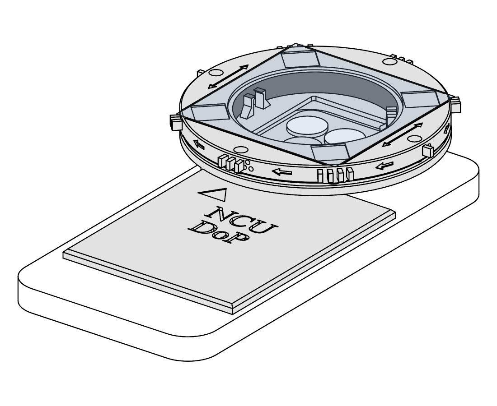

Fig. 1. 安裝在 iPhone 上的 Rotator。底座固定，轉盤帶動偏振片。

## 2. 開始前的準備

套件有 15 顆小型強力磁鐵及 MagSafe 磁鐵貼片。請遠離兒童、寵物、心律調節器與其他植入式醫療裝置。吞入磁鐵有危險。

圓磁鐵保持疊成一串，裝入時不要翻面。修整列印支撐時，刀口朝外並遠離手部。安裝軸承時只按外環，避免灰塵與沙粒進入。

拿偏光片時握住邊緣。找透光軸時先保留保護膜；貼好偏光片後再撕除。拍攝前必須撕掉保護膜。

準備小鉗子、美工刀、軟布、細筆，以及鈍針或牙籤。在乾淨的桌面操作。

## 3. 清點零件

| 零件 | 數量 | 用途 |
| --- | --- | --- |
| 底座 | 1 | 固定軸承並連接 MagSafe 底板。 |
| 轉盤 | 1 | 固定偏光片，並在軸承上旋轉。 |
| MagSafe 底板 | 1 | 放置磁鐵貼片，將底座連到 iPhone。 |
| MagSafe 磁鐵貼片 | 1 | 帶尾端的磁鐵環。外徑 54 mm、內徑 46 mm。兩面有黏性，各覆一層藍色膜。 |
| 薄型軸承 | 1 | 50 × 65 × 7 mm，讓轉盤平順旋轉。 |
| 圓磁鐵 | 12 | 底座 8 顆、轉盤 4 顆，讓轉盤在各角度定位。 |
| 方磁鐵 | 3 | 4 × 4 × 4 mm，將軸承內環固定於底座。 |
| 線性偏光片 | 1 | 60 × 60 mm，篩選沿透光軸振盪的光。 |
| 奈米凝膠貼片 | 9 | 10 × 10 mm。4 片固定偏光片，5 片連接 MagSafe 底板與底座。 |

底座固定在 iPhone 上，轉盤則可旋轉。底座指標對準轉盤邊緣的一道、兩道、三道或四道凸紋，表示目前位置。小箭頭表示旋轉方向，雙向箭頭表示偏光片的 0° 透光軸。

| 位置 | 指標對準的凸紋數 | 角度 |
| --- | --- | --- |
| 1 | 1 | 0° |
| 2 | 2 | 45° |
| 3 | 3 | 90° |
| 4 | 4 | 135° |

每組凸紋在相對兩側各出現一次，代表相同的偏光片角度。轉盤每 45° 定位一次，一圈共有 8 次（Fig. 2、Fig. 3）。

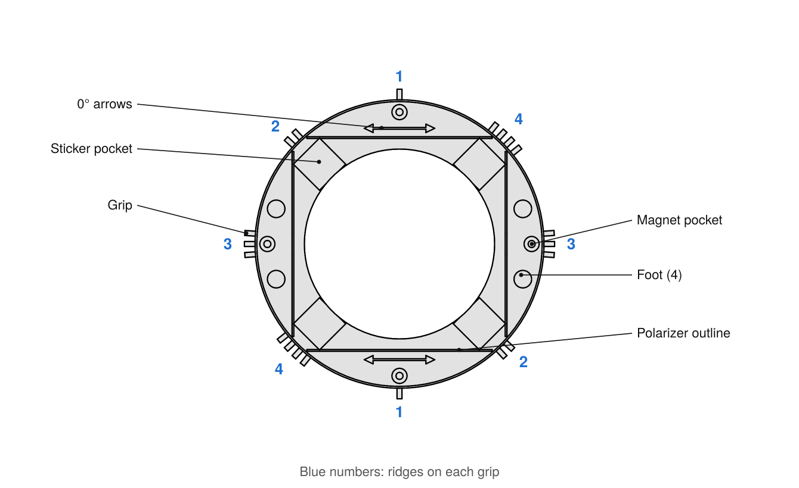

Fig. 2. 轉盤位置圖：四個貼片槽、轉向箭頭、透光軸箭頭，以及一至四條凸紋。

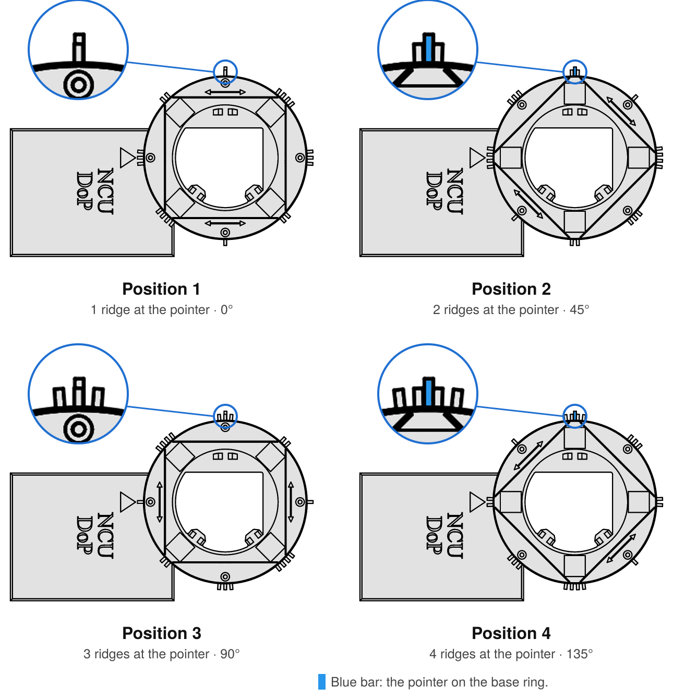

Fig. 3. 位置 1–4 對應 0°、45°、90°、135°。讀取底座指針所對應的凸紋組。

## 4. 組裝轉盤

校正、軸承與 MagSafe 安裝動畫可在網站播放：https://teyuan-lab.github.io/S012Cam-webpage-manual/zh/rotator.html#assembly-movie

### 步驟 1：檢查列印件

若有列印支撐，先用小鉗子取下較大的支撐，再以美工刀小心修平殘料。刀口朝外，遠離手部。無支撐列印可跳過拆除。確認圓磁鐵孔、軸承凹槽和方磁鐵卡座均無殘料。

### 步驟 2：壓入圓磁鐵

將 12 顆圓磁鐵保持疊成一串。每次從同一端滑下一顆，讓同一面先入孔。底座裝 8 顆，轉盤裝 4 顆，壓至與表面齊平。若裝反，用鈍針從孔後推出，再翻面裝回（Fig. 4、Fig. 5）。

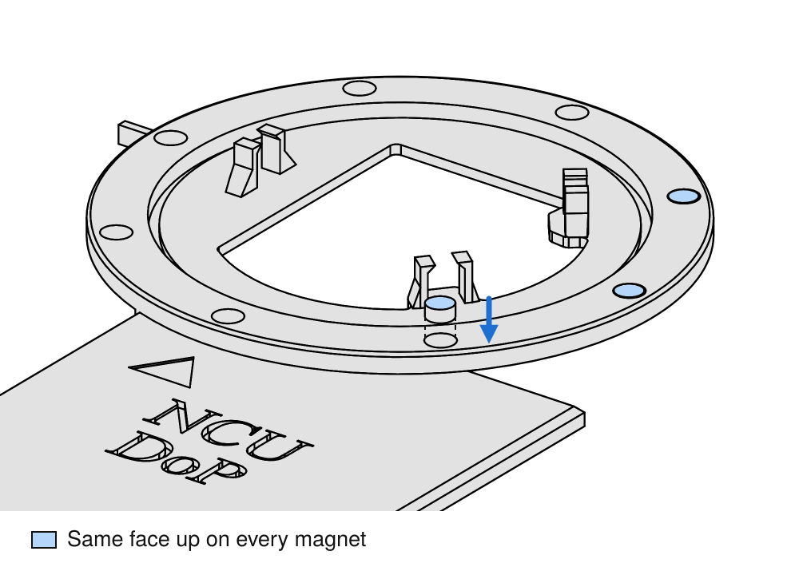

Fig. 4. 每顆圓磁鐵的朝向保持一致。每次從磁鐵疊的同一端取下。

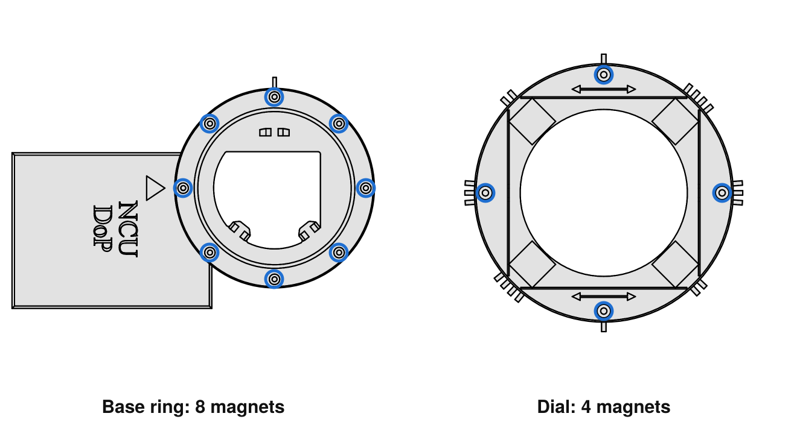

Fig. 5. 底座裝八顆圓磁鐵，轉盤裝四顆。

### 步驟 3：安裝軸承

將轉盤翻面，把軸承放入圓形凹槽。沿外環均勻按壓，直到貼住止擋（Fig. 6）。

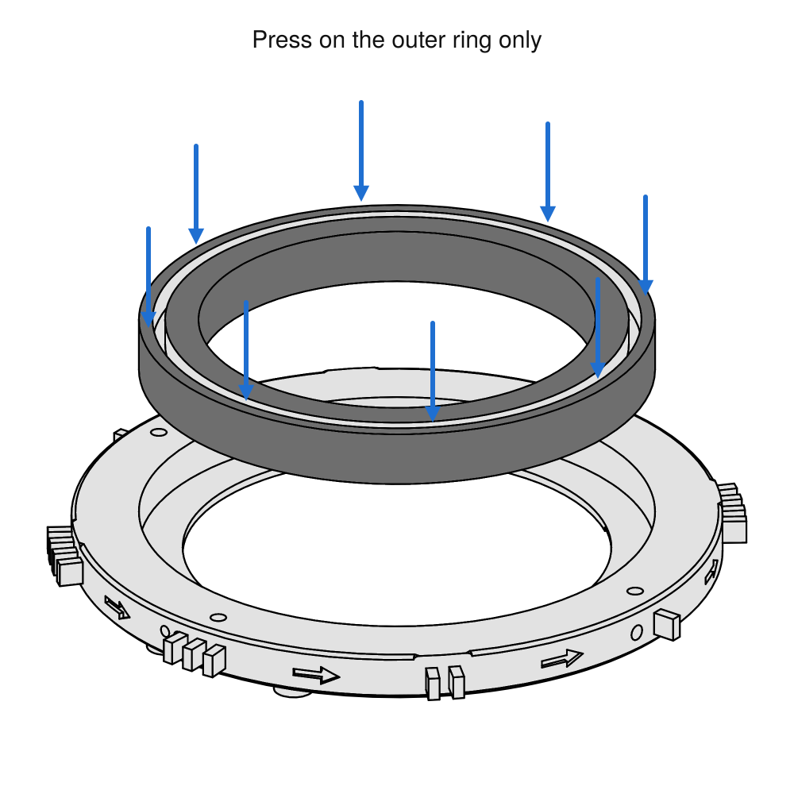

Fig. 6. 只按壓軸承外環，四周均勻施力。

### 步驟 4：裝到底座

把轉盤和軸承放到底座上，讓軸承內環套住底座凸台（Fig. 7）。

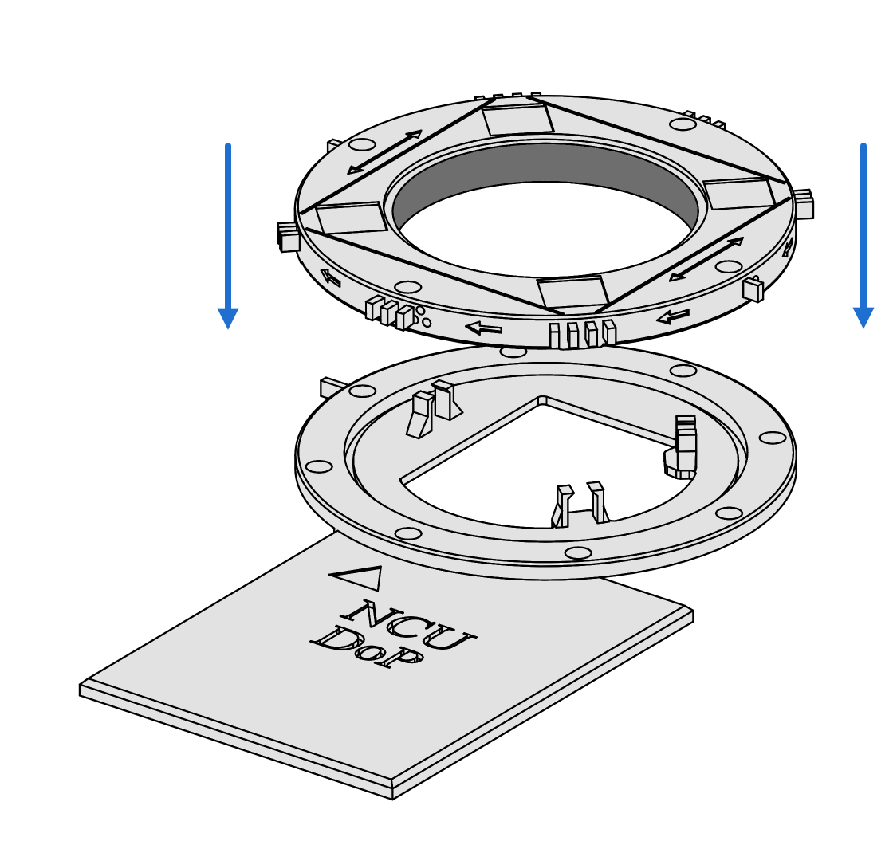

Fig. 7. 將轉盤與軸承一起套到底座凸台。

### 步驟 5：插入方磁鐵

從轉盤中央，將 3 顆方磁鐵分別放入卡座。它們會把軸承內環固定在底座上（Fig. 8）。

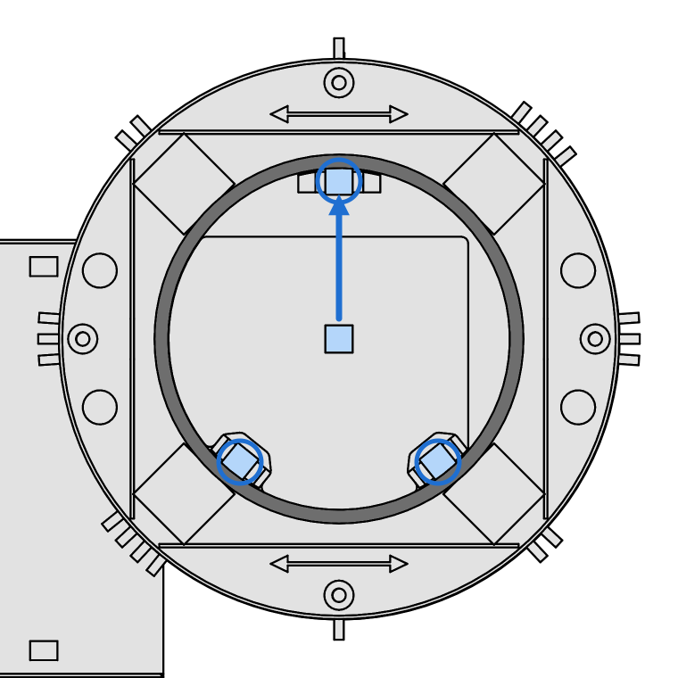

Fig. 8. 三個藍圈標示方磁鐵卡座。

### 步驟 6：檢查旋轉

沿箭頭轉一圈。每 45° 應卡住一次，轉動時不應摩擦。轉盤與底座間約有 1 mm 間隙。方磁鐵應留在底座與軸承內環上，不隨轉盤轉動。若某一格排斥轉盤，將該格的圓磁鐵翻面（Fig. 9）。

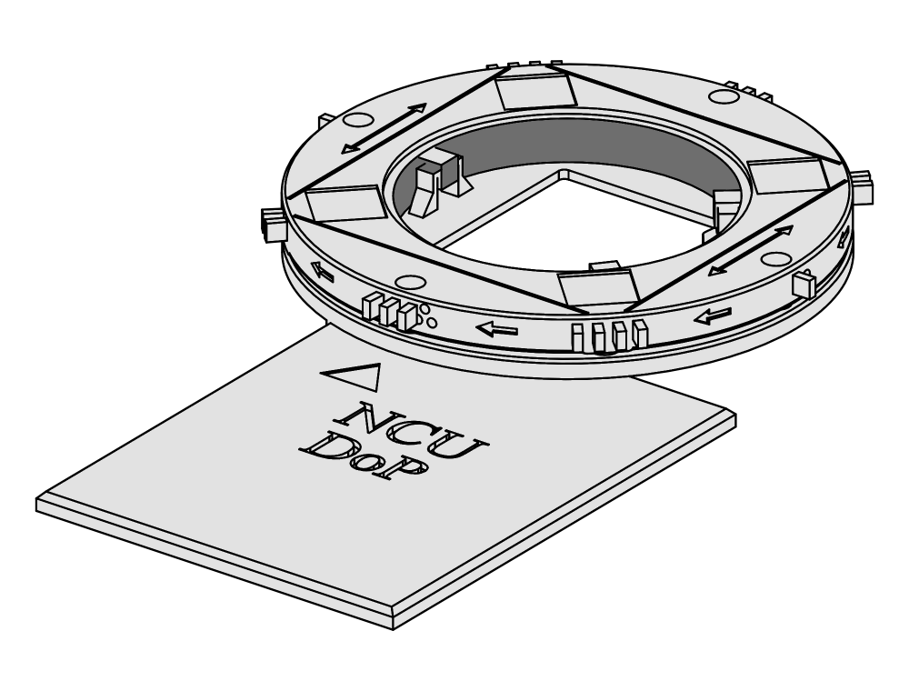

Fig. 9. 貼偏振片前先檢查組裝好的轉盤，轉動時應沒有摩擦。

## 5. 安裝與校正偏光片

### 找出透光軸

1. 先保留保護膜。
2. 從較低的角度，觀察玻璃桌面等水平亮面的反光。
3. 將偏光片放在眼前慢慢旋轉，直到反光最暗。
4. 保持偏光片方向不變，在保護膜靠近一角處畫一條垂直短線。這條線表示透光軸（Fig. 10、Fig. 11、Fig. 12）。

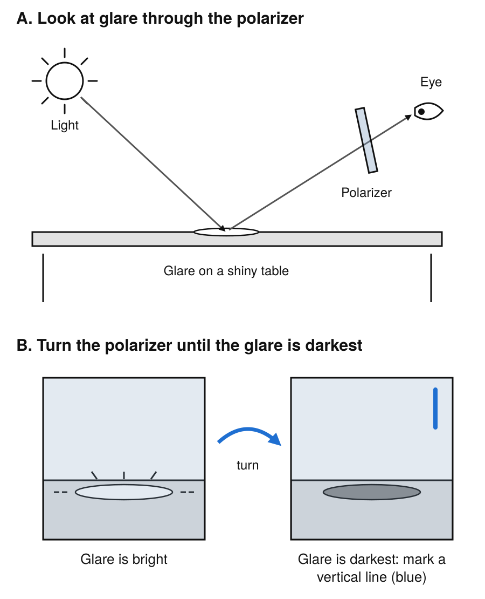

Fig. 10. 透過偏振片看反光，慢慢轉動至反光最暗。

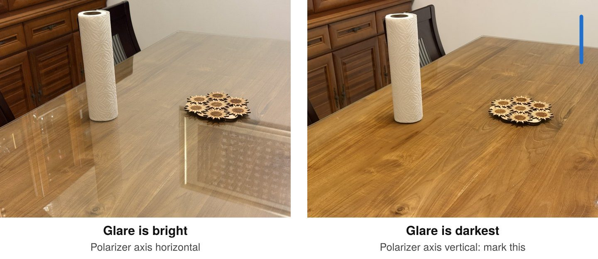

Fig. 11. 同一張玻璃桌：左側反光明亮，右側反光被抑制。

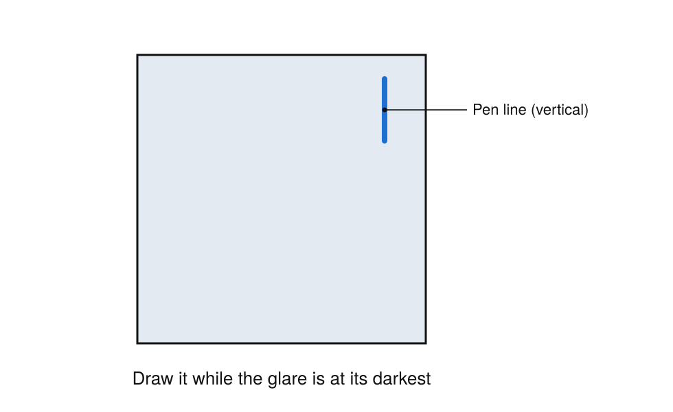

Fig. 12. 反光最暗時，在保護膜上畫出垂直的透光軸標線。

### 貼到轉盤

1. 將轉盤轉到位置 1，讓底座指標對準一道凸紋。
2. 在轉盤四個凹槽各貼一片凝膠貼片，撕開上層離型膜。
3. 讓偏光片保護膜朝上，筆線平行於雙向箭頭，邊緣對準刻線。
4. 按壓四角固定，再撕掉保護膜。偏光片四角略超出圓形轉盤是正常的（Fig. 13、Fig. 14）。

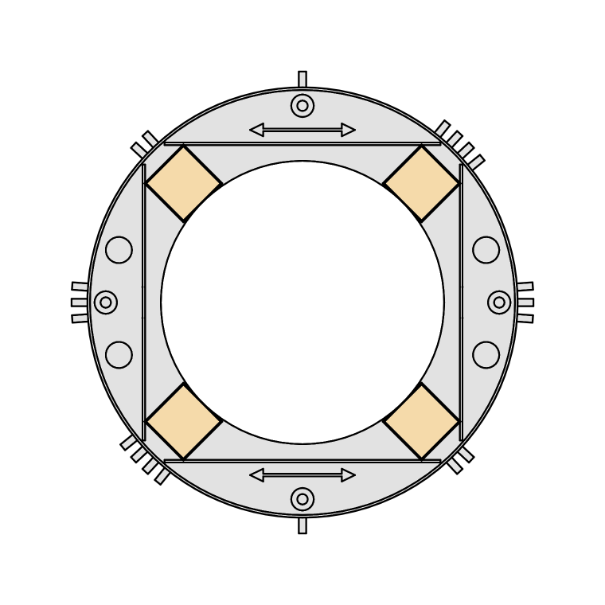

Fig. 13. 四片凝膠貼片放在轉盤凹槽內，固定偏振片。

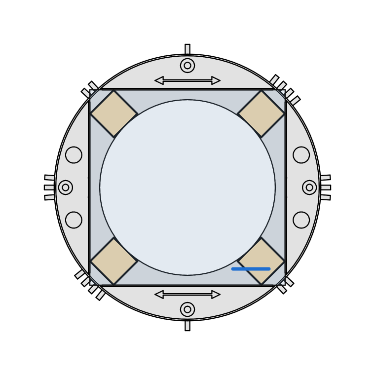

Fig. 14. 在位置 1，讓透光軸標線平行於雙頭箭頭。

## 6. 安裝 MagSafe 底板並裝上 iPhone

### 安裝磁鐵貼片

1. 先不撕藍膜，將貼片兩面分別靠近 iPhone 背面，找出吸得牢的一面。
2. 只撕掉這一面的藍膜，將它朝下壓入 MagSafe 底板的環形凹槽，尾端放入槽口。兩個小耳朵屬於藍膜，會隨膜一起取下。
3. 沿整個圓環壓牢。另一面的藍膜等連接底座前再撕。

### 連接底板與底座

1. 將剩下的 5 片凝膠貼片放入五個方形凹槽：中央一片、四角各一片。
2. 撕掉貼片上層離型膜及磁鐵貼片另一面的藍膜。
3. 將 MagSafe 底板與底座背面邊緣對齊。底板的平背面應朝向 iPhone。
4. 均勻按壓 10 秒（Fig. 15）。

### 裝上手機並檢查

用軟布擦乾淨 iPhone 背面。將轉盤吸附上去，讓鏡頭窗對準後鏡頭。開啟 S012Cam，逐一檢查可用鏡頭。若有邊緣被擋住，取下轉盤後重新吸附。

若要取得完整超廣角畫面，先取下手機殼。手機殼可能遮住超廣角畫面的左上角。

第一次量測前，保持手機水平，拍攝水平亮面的反光。結果應顯示水平偏振。若顯示垂直偏振，將偏光片轉 90° 後重新貼合。

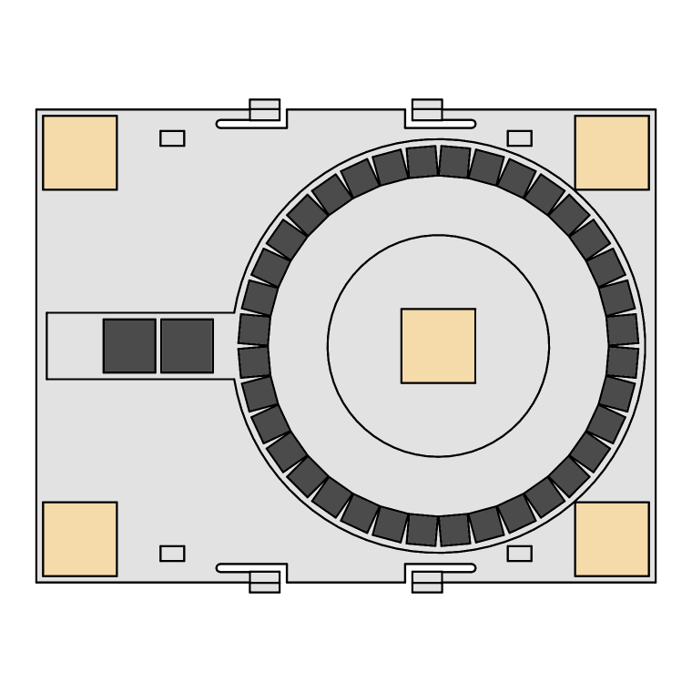

Fig. 15. MagSafe 底板的環槽、尾槽與五片凝膠貼片。

## 7. 相機畫面

橫拿 iPhone。照片是 iPhone 16 Pro 拍攝第一張之前的畫面，請依藍色編號閱讀下表。相機畫面不再顯示版本號（Fig. 16）。

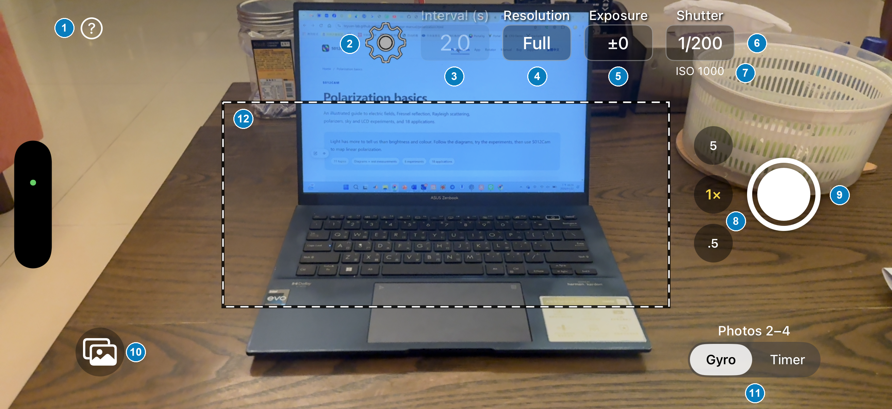

Fig. 16. 2026 年 11 月提供的最新版相機截圖，沿用 1–12 控制位置編號。此例 Resolution 為 Full、Shutter 為 1/200 s、ISO 為 1000；這些是截圖當時的設定，不代表全部都是預設值。

| 編號 | 名稱 | 操作說明 |
| --- | --- | --- |
| 1 | 使用指南與支援（?） | 點一下，開啟 S012Cam 網站。 |
| 2 | 設定（齒輪） | 點一下，開啟設定。 |
| 3 | Interval (s) | 設定 Timer 模式的拍攝間隔，單位為秒。預設為 2 秒。Gyro 模式不使用此設定，欄位會變暗。 |
| 4 | Resolution | 選擇計算用的解析度：Full、1/2、1/3、1/4、1/5、1/6、1/8 或 1/10。較低解析度可加快計算。 |
| 5 | Exposure | 以 1/3 EV 為一級，在 −2 至 +2 EV 間調整曝光補償。紅色或藍色通道訊號偏弱時，可嘗試調整。 |
| 6 | Shutter | 選擇 1/60 至 1/1000 秒，或 Custom。預設 1/200 秒適合手持拍攝。照片反覆被判定模糊時，選擇更快的快門。 |
| 7 | ISO | 顯示 App 選用的 ISO。點按預覽畫面測光時，App 保留所選快門並調整 ISO。出現 ⚠ 表示 ISO 已達限制；影像可能過暗、過亮，或實際快門已延長。 |
| 8 | 鏡頭選擇 | 點選要使用的鏡頭。所選鏡頭顯示黃色。圖中由上到下為 5、1×、.5。實際按鈕依 iPhone 機型顯示，見第 1 節。 |
| 9 | 快門 | 在 0° 位置按一次，拍攝第一張。Gyro 模式下，之後轉動轉盤並持穩，第 2 至第 4 張會自動拍攝。拍攝中也可按快門，立即拍下目前這張。 |
| 10 | 已儲存量測 | 點一下，開啟已儲存的量測清單。 |
| 11 | Photos 2–4 | 選擇 Gyro 或 Timer。Gyro 為預設：轉動轉盤後持穩，等待自動拍攝。Timer 則依第 3 項的固定間隔拍攝。 |
| 12 | 虛線量測框 | 將要量測的目標保持在框內。拍完第一張後，預覽上會出現第一張的輪廓，協助後續照片對齊。眼睛按鈕可顯示或隱藏輪廓；圖中尚未出現。 |

## 8. 拍攝四個角度

先選擇如何握持或固定 iPhone，再選擇第 2 至第 4 張的觸發方式。這是兩個分開的選擇。

| 手機與偏振片配置 | 建議拍攝模式 | 計算方式 |
| --- | --- | --- |
| 手持 iPhone＋Rotator | Gyro；也可選 Timer | 建議 Align and Calculate。 |
| 腳架或固定 iPhone＋Rotator | Timer 較方便；也可選 Gyro | 手機與場景未移動時，可選 Calculate Without Aligning。 |
| 固定 iPhone＋手持偏振片 | Timer | 保持固定時可不對齊；手動估計角度的數值不作定量參考。 |

### 情形一：手持 iPhone，使用 Polarizer Rotator

雙手橫拿 iPhone，螢幕朝向自己。右手拇指操作螢幕，左手中指轉動轉盤。從使用者這側看，轉盤為逆時針旋轉。每次轉一格。手肘靠近身體，輕觸螢幕。

選擇靜止的目標並維持光線穩定。將目標保持在虛線量測框（12）內。點按預覽對焦與測光；App 會保留所選快門並調整 ISO。預設 1/200 秒適合手持拍攝。

### 情形二：使用腳架或固定 iPhone

將 iPhone 裝在穩固的腳架上，或放在穩定、不會滑動的支撐物上。固定好構圖與鏡頭方向。轉動 Polarizer Rotator 或觸碰螢幕時，不要推動手機。讓手機與被攝物在四張拍攝期間都保持不動。

可以使用 Gyro 或 Timer。若手機固定得很好，旋轉偏光片未必會讓手機產生足夠動作供 Gyro 偵測；此時使用 Timer 較方便。設定足夠的拍攝間隔，轉好角度並等振動停止。四張拍完後，可直接選 Calculate Without Aligning，不必做影像對齊。

若手機、被攝物或構圖曾移動，就不要因為使用腳架而假定影像已對齊。可選 Align and Calculate，或重新拍攝。

### Gyro 模式：只按一次快門

1. 將 Photos 2–4（11）設為預設的 Gyro。轉盤先放在位置 1，即 0°。
2. 按快門（9），拍攝第一張。
3. 第一張照片的輪廓會疊加在預覽上。依照下一個角度提示操作，例如「Photo 1 ✓ Turn to … · 45°」。
4. 轉到位置 2，即 45°。持穩手機，讓畫面對齊輪廓；允許位移為影格的 3%。陀螺儀會偵測轉動，待手機穩定且畫面對齊後，自動拍攝第二張。
5. 依序轉到位置 3（90°）和位置 4（135°）。每次轉動後持穩，等待自動拍攝。
6. 四張完成後，選 Align and Calculate 或 Calculate Without Aligning。

如果手機沒有感應到動作，提示可能一直停在「Turn to XX」，不會進入「Hold still」。先將偏振片轉到提示的角度，稍微輕觸或輕敲手機一下，再持穩等待；App 感應到動作後便可繼續等待穩定並拍攝。操作時保持構圖不變。

眼睛按鈕可顯示或隱藏第一張的輪廓。它會在拍完第一張後出現，因此相機畫面編號照片中尚未顯示。

畫面顯示「Hold still…」時，虛線量測框內的白色輪廓提供對照基準（Fig. 17）。持穩並讓實際場景對齊輪廓。左下角的眼睛按鈕可隱藏或顯示輪廓，不是關閉位置檢查。拍攝螢幕時也應固定顯示內容，如同拍攝其他靜止物體。

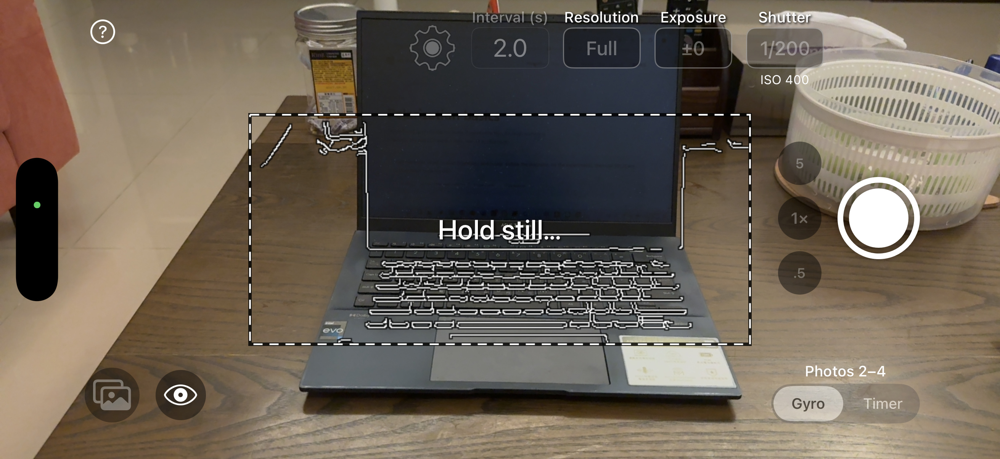

Fig. 17. 拍完第一張後的實際 Gyro 畫面，可見白色輪廓、眼睛按鈕與等待穩定的「Hold still…」提示。

### 檢查與重拍

每張照片拍完後，都會立即檢查模糊與位置。若不合格，App 會說明原因並要求持穩。保持目前的偏光片角度，只重拍這個角度；先前照片會保留。

「Hold still…」表示正在等手機穩定。白牆等缺少紋理的區域無法檢查位置，會顯示「Plain area: position is not checked — keep the phone steady.」。此時請自行保持手機穩定。

提示後約 8 秒仍未拍攝時，會出現以下按鈕：

| 按鈕 | 操作 |
| --- | --- |
| Capture now | 立即拍攝目前這張。 |
| Redo previous | 重拍上一張。 |
| Cancel | 停止這組拍攝。 |

拍攝期間，快門按鈕隨時有效。按一下就會立即拍下目前這張。

### Timer 模式

將 Photos 2–4（11）設為 Timer，再設定 Interval（3），預設為 2 秒。按快門拍第一張後，在下一次間隔結束前轉到提示的角度。第 2 至第 4 張依固定間隔拍攝。Gyro 模式不使用 Interval，因此該欄位會變暗。

### 沒有 Rotator：手持偏振片並手動轉動

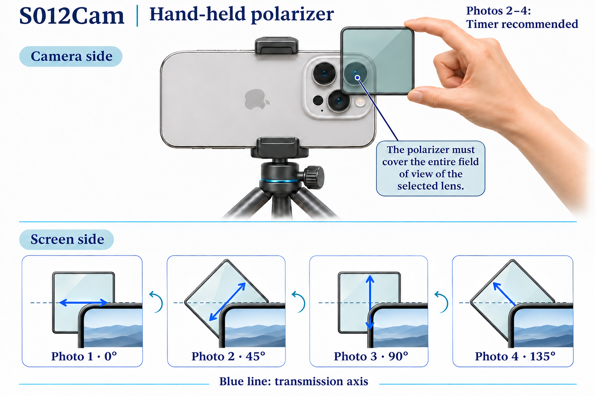

Fig. 18. 建議以腳架或穩固支撐物固定 iPhone，並將 Photos 2–4 選為 Timer。上圖 Camera side 從鏡頭側看；下圖 Screen side 從螢幕側看，前景手機螢幕遮住偏振片右下角。藍線表示 0°、45°、90°、135° 的透光軸。每個角度都要讓所選鏡頭的完整視野通過偏振片透明區域。

1. 將 iPhone 裝在腳架上或固定好。選擇靜止的場景。
2. 握住線性偏光片的邊緣，放在所選鏡頭前。四個角度都要讓所選鏡頭的完整視野通過偏光片的透明區域。選用夠大的偏光片，靠近鏡頭但不要碰觸鏡頭；手指與邊框都不得進入視野。保持偏光片大致平行於手機背面，每個角度都檢查預覽是否被遮擋或出現暗角。
3. 先讓透光軸平行於橫放 iPhone 的長邊，作為 0°。注意：偏光片的外框或邊緣不一定就是透光軸。
4. 將 Photos 2–4（11）設為 Timer。預設間隔為 2 秒；若來不及轉動及停穩，設定更長時間。
5. 按快門拍第一張。從螢幕這側看，依序逆時針轉到 45°、90°、135°，每次相對 0° 位置累計角度。依提示在下一張拍攝前轉好，保持角度並停穩。
6. 不要移動 iPhone。若手機與場景始終不動，四張拍完後選 Calculate Without Aligning（Fig. 18）。

手動轉動時，角度、傾斜與位置不容易重複。這種方式可觀察偏振圖樣，但數值不作定量參考。固定手機與使用 Timer 可減少操作干擾，不能消除偏振片角度誤差。這項限制只指手持偏振片、手動估計角度的方式。使用 Polarizer Rotator 並正確安裝、校正及依定位角度拍攝時，量測數值可作參考。

### 對齊與計算

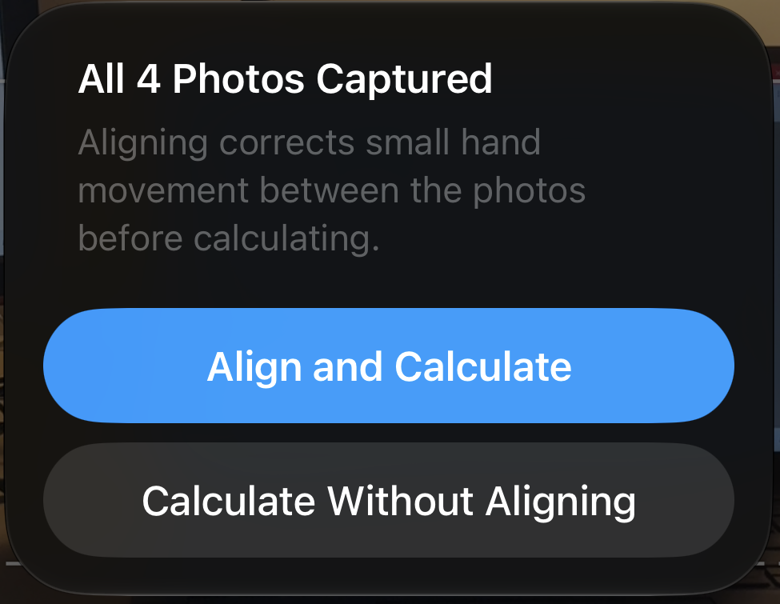

Fig. 19. 四張照片拍完後的對話框。上方為 Align and Calculate，下方為 Calculate Without Aligning。截取自你提供的實際畫面。

手持 iPhone 時，建議選 Align and Calculate，修正照片間的小幅位移。使用腳架或已固定 iPhone，且手機與場景在四張拍攝期間都未移動時，可直接選 Calculate Without Aligning，使用原始照片計算（Fig. 19）。

若出現「Photos Don’t Line Up」，先看四張照片中量測框的對齊比例（Fig. 20）。此例只有 10% 對齊；洋紅色覆蓋表示未對齊區域。風吹樹葉、水面、人、移動陰影，或近遠物體的視差，都可能造成這個問題。先排除原因，再選 Retake 重拍整組。Continue without aligning 會用未對齊照片計算，錯位邊緣可能產生假的偏振；必須了解限制才繼續。若其他情況提供 Use aligned areas (…%)，則僅使用通過檢查的區域。

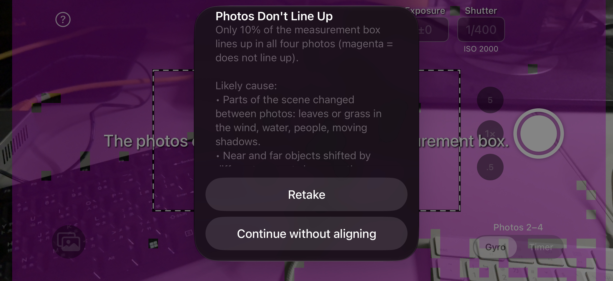

Fig. 20. 實際對齊警告。此例量測框僅 10% 對齊，畫面提供 Retake 與 Continue without aligning。10% 是這次量測的結果，不是固定的判定門檻。

近物與遠物同時入鏡時，視差可能讓對齊失敗。可退後、選較平面的場景，或改用腳架。若反覆被判定模糊，選擇更快的快門。量測區內盡量避開移動的人、樹葉與波浪（Fig. 21）。

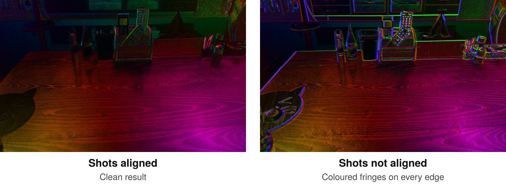

Fig. 21. 同一場景：左側照片已對齊，右側照片有位移。位移邊緣可能產生假的偏振色彩。

## 9. 查看量測結果

| 顯示模式 | 讀圖方式 |
| --- | --- |
| **AoLP+DoLP** | 色相表示線偏振角，亮度表示線偏振度。 |
| **DoLP** | 線偏振度。黑色是 **0**，白色是 **1**。 |
| **AoLP** | 線偏振角。對照色標讀取色相對應的角度。角度以第一張照片的偏光片方向為 **0°**，朝第二張照片的方向計算，範圍為 **0° 至小於 180°**。黑色表示角度未定義。 |

選 **RGB** 查看合成結果，或選 **R**、**G**、**B** 查看單一色彩通道。合成結果會先平均三個通道的線偏振 Stokes 參數，再計算 DoLP 和 AoLP。

**各個影像都支援手指縮放與點選**，包括 AoLP+DoLP、DoLP、AoLP，以及 RGB、R、G、B 通道。用兩指縮放，拖移可查看其他區域。放大後可點 **1×** 恢復原畫面。點一下結果圖進入全螢幕，再點選要查看的像素，就能讀取數值並在色標上查看對應位置。相差 **180°** 的角度代表同一個偏振方向。DoLP 很低時，解讀 AoLP 須特別留意。

點 **Tap for details** 查看對齊狀態和曝光警示。使用局部對齊時，洋紅色區域沒有可用的量測值。

### 範例 1：讀取結果畫面

筆電與桌面的同一個場景可用不同顯示模式與色彩通道比較（Fig. 22）。主圖為 AoLP+DoLP（RGB）：色相表示線偏振角，亮度表示線偏振度，不是物體原本的顏色。

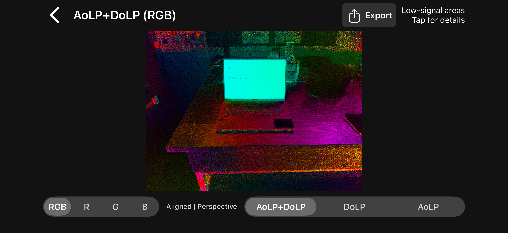

Fig. 22. 最新提供的結果總覽。螢幕、鍵盤、掌托與桌面呈現不同偏振。底部顯示 Aligned | Perspective；右上角提示 Low-signal areas。

左下角切換 RGB、R、G、B；右下角切換 AoLP+DoLP、DoLP、AoLP。Aligned | Perspective 是這筆結果的對齊狀態，不代表畫面每一點都沒有誤差。上方 Export 可匯出結果。

點 Tap for details 查看此筆資料的低訊號、過曝或其他警示。圖中只有 Low-signal areas 提示；並不是每筆量測都會同時出現所有警示。暗處的彩色雜點不應直接解讀成可靠的偏振細節。

### 範例 2：點選位置讀取角度與偏振度

點結果圖開啟全螢幕讀值畫面，再點選想查看的位置。十字與上方數字會對應同一個取樣點（Fig. 23）。此例十字位於筆電掌托，不是 LCD 螢幕。

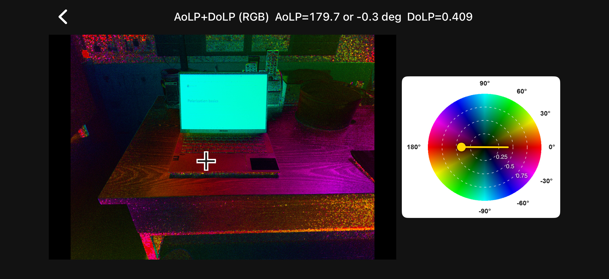

Fig. 23. 掌托選取點的 AoLP = 179.7°，也可寫成 −0.3°；DoLP = 0.409。數值只屬於十字所在位置。

179.7° 與 −0.3° 相差 180°，表示同一條線偏振軸。色輪的黃色標記方向表示 AoLP，離中心的距離表示 DoLP。中心為 0、外緣為 1；0.409 表示此點的線偏振度約為 40.9%，不能套用到整個掌托或螢幕。

### 放大影像再選點

在全螢幕圖上以雙指放大、拖曳平移，再點選細部位置。右上角出現 1× 時，點它可回到原始檢視比例（Fig. 24）。AoLP+DoLP、DoLP、AoLP 及 RGB／R／G／B 各通道都可用手勢查看。

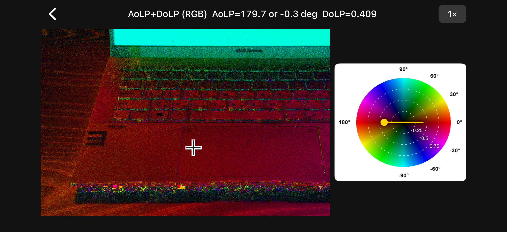

Fig. 24. 放大後的同一個例子，顯示 1× 重設按鈕；上方仍為 AoLP = 179.7°／−0.3°、DoLP = 0.409。放大顯示本身不會增加量測解析度，也不會改變同一取樣點的數值。

### 範例 3：讀取 DoLP 灰階圖

DoLP 圖以黑色表示 0、白色表示 1，灰階代表線偏振度，而不是一般照片的亮度。點選位置後，在上方讀值，並在下方灰階尺查看黃色標記（Fig. 25）。

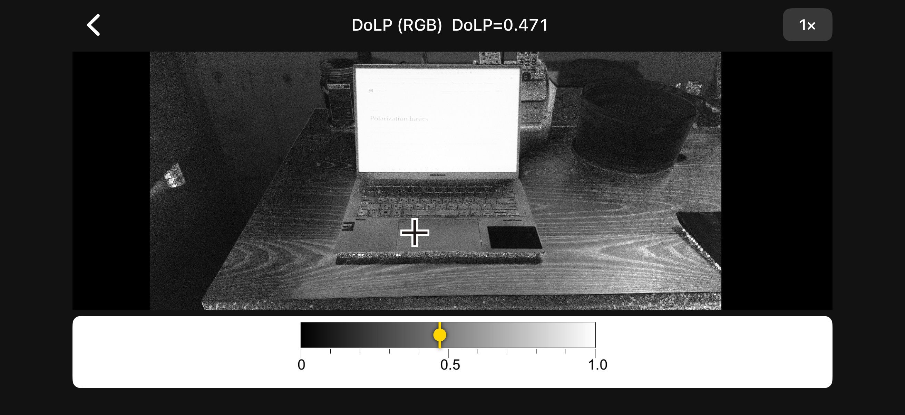

Fig. 25. 最新提供的 DoLP（RGB）畫面，掌托選取點為 0.471。它與 Fig. 23 的取樣位置不同，數值不必相同；不能因為是同一場景就直接比較兩個讀值。

螢幕在這張 DoLP 圖上較亮，掌托與桌面則有不同灰階。應在各區域個別點選、查看品質警示後再比較，不能只依假色或畫面亮度判定可靠性。

## 10. 儲存、分享與匯出

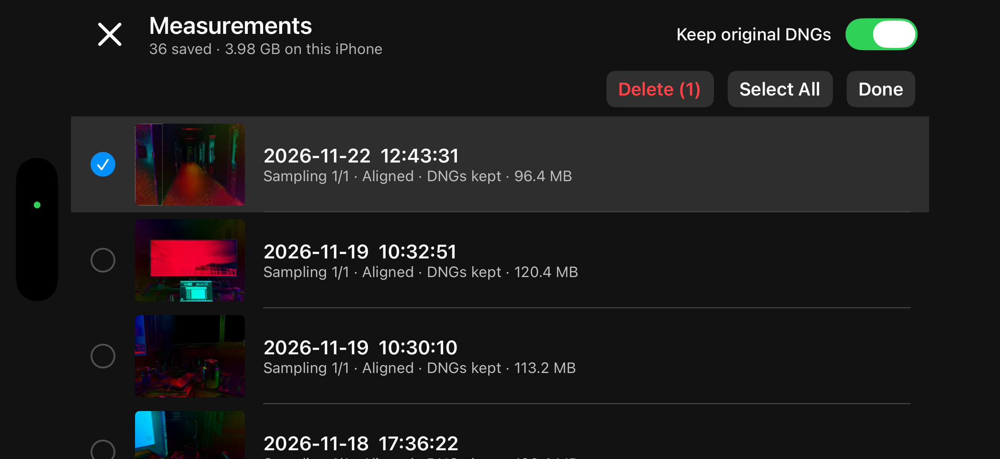

Fig. 26. 最新提供的 Measurements 畫面，已進入多筆選取模式。此例顯示 36 筆、共 3.98 GB，且選取了 1 筆；筆數與容量都是這台 iPhone 當時的範例。

右上角 Keep original DNGs 為開啟。藍色勾選圓圈表示已選 1 筆，因此按鈕為 Delete (1)。Select All 可全選，Done 可離開選取模式。若要開啟某筆結果，先點 Done，再點該列。每列顯示日期、取樣比例、對齊、DNG 狀態及容量；刪除前先確認選取筆數，操作步驟見下文（Fig. 26）。

### 找到並重新開啟量測

1. 在結果畫面點返回箭頭，回到相機畫面。點左下角的 **Measurements** 圖示。
2. 依拍攝日期和時間找量測，最新的量測排在最上方。每列會顯示縮圖、檔案大小、是否有 DNG，以及可用的取樣和對齊資訊。
3. 點一下該列就能重新開啟結果。如果畫面顯示 **Done**，先點它離開選取模式。

S012Cam 會將完成的量測存到 iPhone。如果結果畫面顯示 **Save incomplete**（儲存未完成），可點 **Tap for details** 查看哪些檔案未能儲存。

### 選擇是否保留原始 RAW 照片

開始下一次拍攝前，在 **Measurements** 設定 **Keep original DNGs**（保留原始 DNG）。這個開關預設開啟，會保留四張原始 RAW 照片。若要節省空間，可關閉開關。App 仍會儲存重新開啟和匯出結果所需的計算資料。各筆已存量測的 DNG 保留狀態，以當時拍攝的設定為準。

### 分享或備份整筆量測

1. 在 **Measurements** 將要分享的量測向左滑，點 **Share**。
2. 在 iPhone 的分享選單選擇可用的目的地，例如 AirDrop 或**儲存到「檔案」**。若要另外備份一份，請選擇 S012Cam 資料夾以外的位置。
3. 到目的地確認資料夾和需要的檔案都在，再刪除原本的量測。

新量測的資料夾包含 `measurement.json`（拍攝設定）、`input_1.tiff` 至 `input_4.tiff`（計算結果所用的資料），以及在開啟保留設定時儲存的 `1.dng` 至 `4.dng`。如果已匯出結果，資料夾裡也會有 `export` 子資料夾。也可以直接到**檔案 App › 瀏覽 › 我的 iPhone › S012Cam** 查看各筆量測的資料夾。

### 刪除量測

- **刪除一筆**。將該筆量測向左滑，點 **Delete**。出現確認提示後，再點一次 **Delete**。
- **刪除多筆**。點 **Select** 後逐筆選取，或點 **Select All** 全選。點 **Delete (n)**，核對提示中的筆數和檔案大小後再確認。若決定保留檔案，可點 **Done** 離開選取模式。

在 S012Cam 內刪除量測，會從 iPhone 永久移除整個量測資料夾，包含原始 DNG 和存在其中的匯出檔。要保留的檔案請先分享或複製一份。

### 匯出量測

1. 開啟量測結果並點 **Export**。
2. 出現 **Export Complete** 後，點 **Share…** 並選擇分享目的地。這裡分享的是存有結果圖和匯出說明的 `export` 子資料夾。若也要分享原始照片和計算資料，請用第 10 節量測清單中的 **Share**。
3. 之後要找匯出檔，可開啟**檔案 App › 瀏覽 › 我的 iPhone › S012Cam**，找到該筆量測的資料夾，再開啟 **export**。

| 檔案 | 用途 |
| --- | --- |
| **PNG** | 供瀏覽的 **AoLP+DoLP**、**DoLP**、**AoLP** 影像，包含 RGB 合成結果與各色彩通道。 |
| **32 位元浮點 TIFF** | 供定量分析的逐像素 **S0**、**S1**、**S2**、**DoLP**、**AoLP** 數值圖。AoLP 以度為單位。無效或未定義的數值存成 **NaN**。 |
| **export.json** | 記錄檔案清單、影像尺寸，以及單位和像素值的說明。 |

舊量測如果標成 **Pictures only**，仍可查看已存的影像，但無法匯出精確的量測數值。

## 11. 取下轉盤與保養

一手握穩 iPhone，另一手握住底座安裝板的一端。像取下其他 MagSafe 配件一樣，從這一端向外傾斜取下。不要拉扯或扭轉轉盤。

凝膠貼片留在轉盤上，取下轉盤時不用拆貼片。若曾拆下偏光片或 MagSafe 底板，貼片沾灰後失去黏性，可用清水沖洗。不要用肥皂、酒精或面紙。完全自然風乾後再裝回。

偏光片用柔軟乾布清潔，不要用酒精或溶劑。轉盤遠離沙、水與高溫，不要長時間放在高溫車內或強烈日照下。

## 12. 常見問題

| 畫面或狀況 | 處理方式 |
| --- | --- |
| Camera Permission | 開啟設定，允許 S012Cam 使用相機。 |
| 找不到某個鏡頭 | 按鈕依 iPhone 機型顯示。等啟動校正完成，再選可用鏡頭。 |
| 停在「Turn to XX」，未進入「Hold still」 | 先轉到指定角度，稍微輕觸或輕敲手機一下，再持穩等待，保持構圖不變。 |
| Gyro 模式沒有自動拍攝 | 轉到提示角度後持穩並對齊輪廓。約 8 秒後可選 Capture now、Redo previous 或 Cancel。也可直接按快門。 |
| 出現 Plain area | 區域缺少紋理，無法檢查位置。保持手機穩定，或改拍有紋理的目標。 |
| 反覆判定模糊 | 選更快的快門，並支撐 iPhone。App 重拍時保持目前角度。 |
| Timer 還沒轉完就拍了 | 加長 Interval，依提示在每張拍攝前轉好角度。 |
| ISO 警示或訊號偏弱 | 查看 ISO（7）與 Tap for details。調整 Exposure（5）或 Shutter（6）後，重新拍完整一組。 |
| 彩邊或對齊失敗 | 持穩、用腳架、退後，或選較平面的場景。嘗試 Align and Calculate。 |
| 角度持續不正確 | 確認 0° 透光軸及 0°、45°、90°、135° 順序，重做第 6 節的偏光片檢查。 |
| 某一定位點排斥轉盤 | 從圓磁鐵孔後推出磁鐵，翻面裝回。 |
| 沒有定位感或轉動摩擦 | 確認 12 顆圓磁鐵壓平。重新安裝軸承，清除支撐殘料或髒污。 |
| 預覽出現暗角 | 重新對準鏡頭窗。要完整超廣角畫面，取下手機殼。 |
| 轉盤容易滑落 | 依第 6 節檢查磁鐵貼片方向。 |
| 底板或偏光片鬆脫 | 用清水洗淨沾灰的凝膠貼片，完全風乾後裝回。 |

支援網站：https://teyuan-lab.github.io/S012Cam-webpage-manual/

App Store：https://apps.apple.com/app/id6834323253

聯絡信箱：teyuan@gmail.com

Department of Optics and Photonics, National Central University, Taiwan.

國立中央大學光電科學與工程學系。
